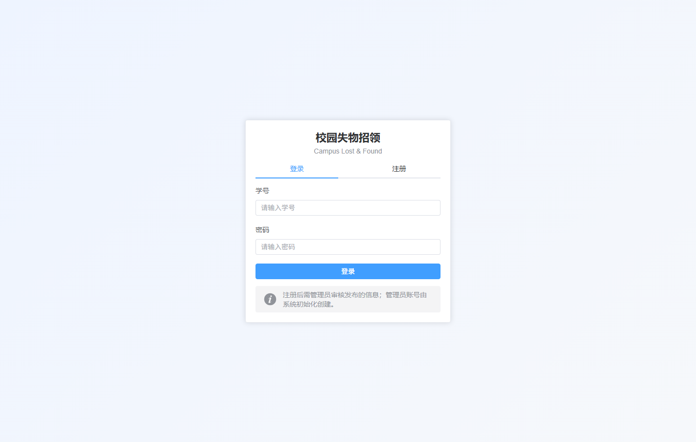
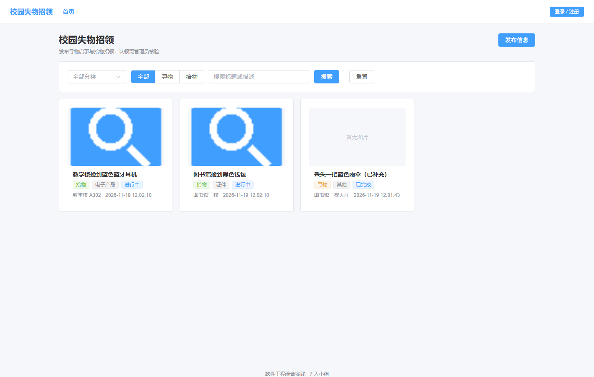
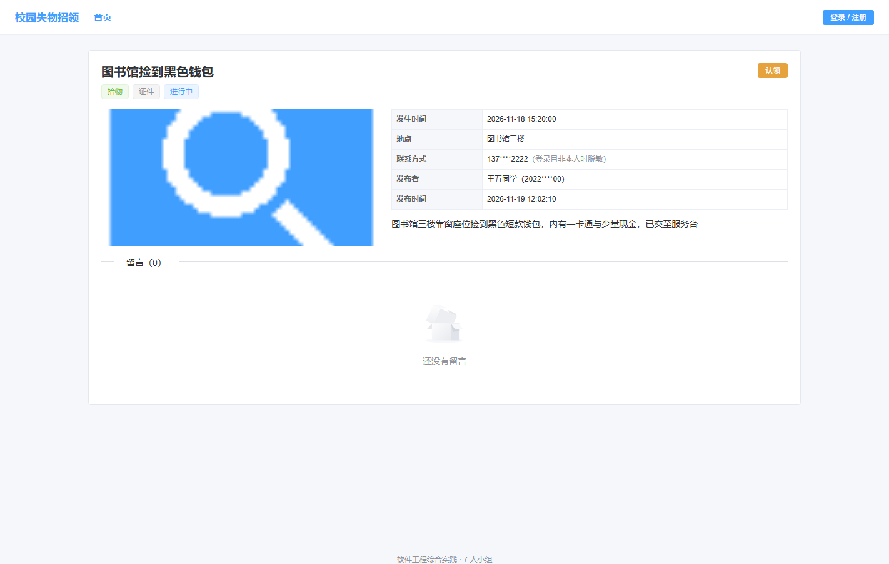
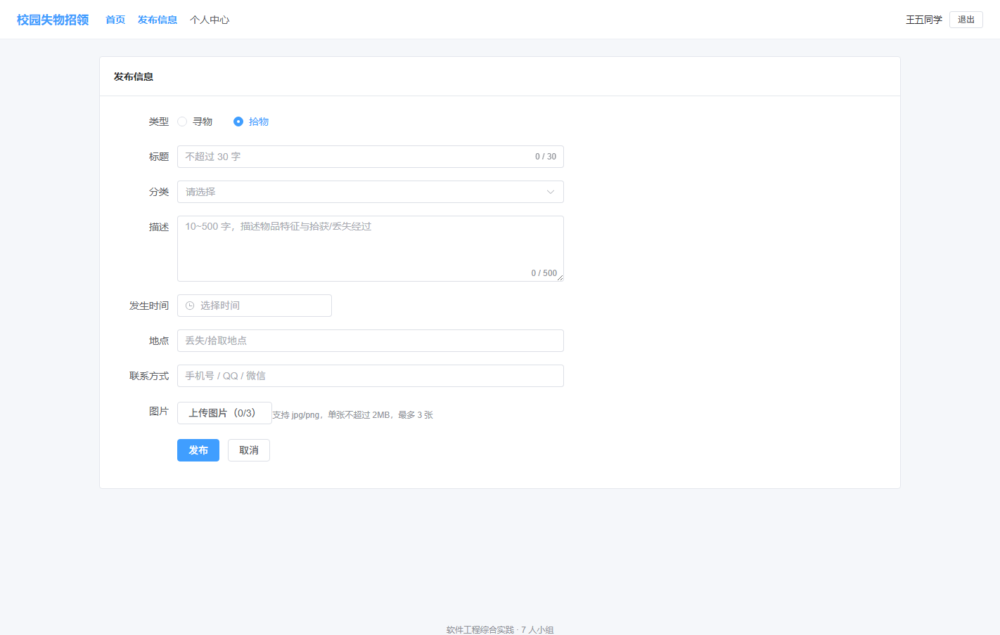
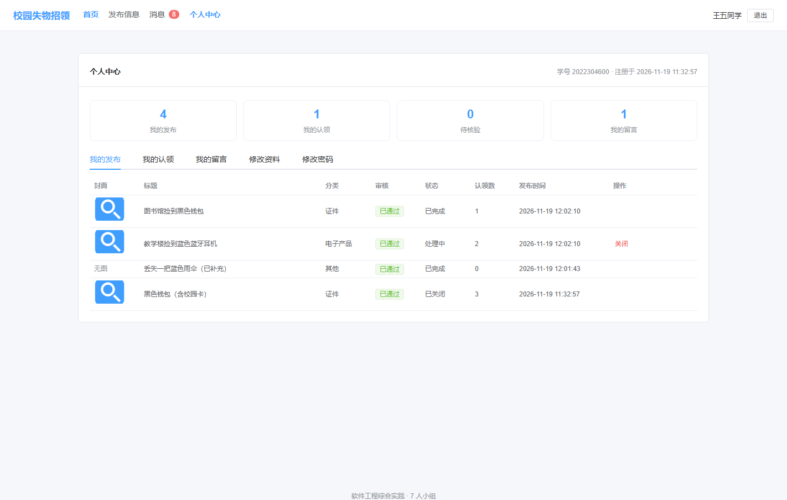
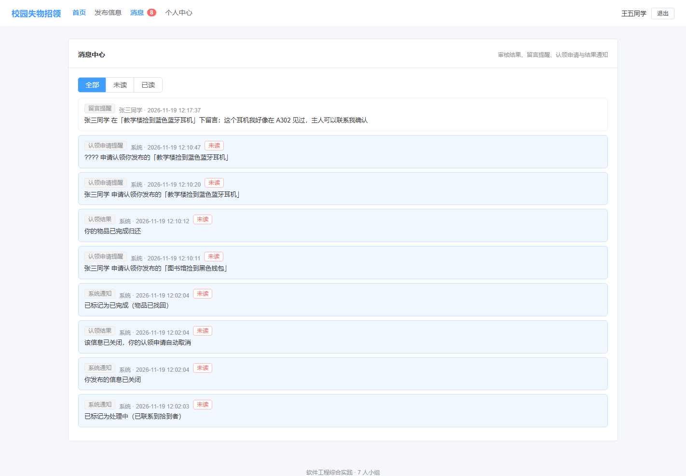
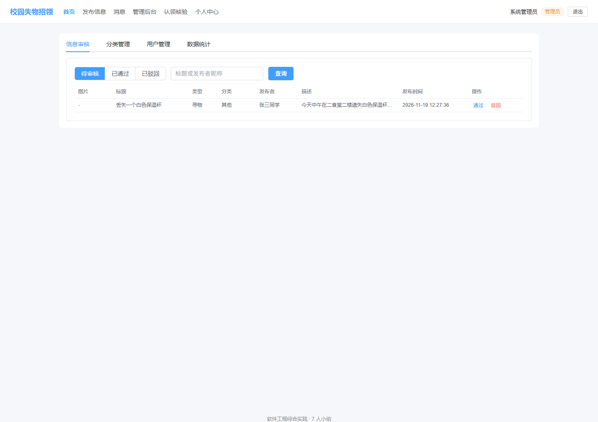
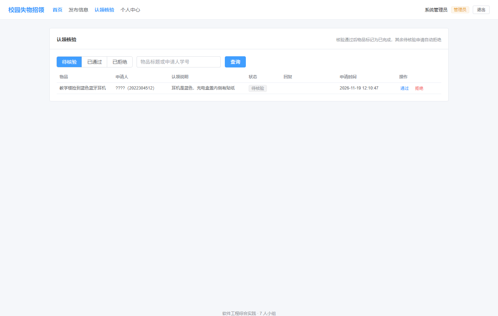
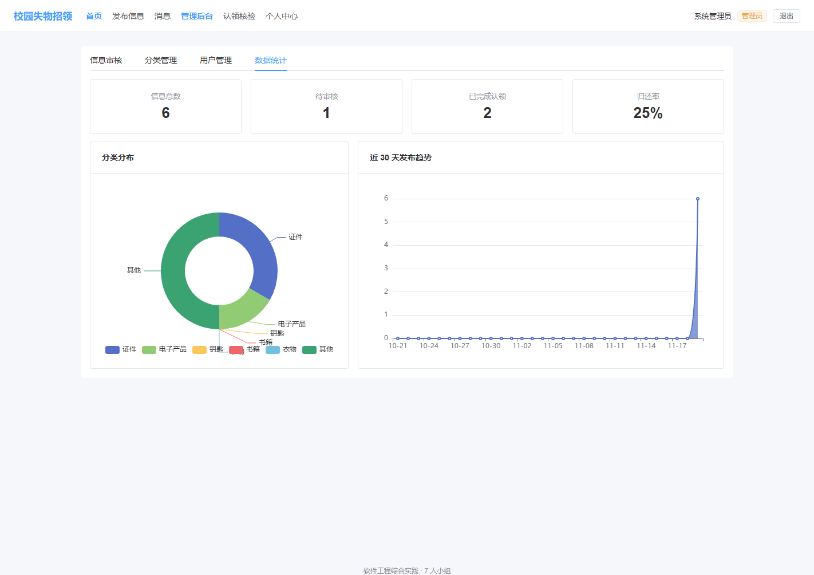

# 校园失物招领系统 · 使用说明书

> 版本：**v1.0.0**（对应 tag `v1.0.0`）
> 适用对象：学生用户、管理员、测试与验收人员
> 编写日期：2026-11-19

---

## 1 文档说明

### 1.1 系统是什么

校园失物招领系统用于在校园内发布**寻物启事**与**拾物招领**，并完成"发布 → 审核 → 浏览 → 认领 → 核验 → 归还"的闭环。系统分三类角色：**游客**（未登录）、**学生用户**、**管理员**。

### 1.2 访问地址

| 入口 | 地址 | 说明 |
|---|---|---|
| 用户端（前台） | <http://localhost/> | 首页、详情、发布、个人中心、消息中心 |
| 管理后台 | <http://localhost/admin> | 审核、分类、用户、统计（管理员） |
| 后端接口 | <http://localhost:8080/api> | 供测试脚本 / 联调使用 |
| 健康检查 | <http://localhost:8080/api/system/health> | 返回服务与数据库状态 |

### 1.3 演示账号（本地环境）

| 角色 | 学号 / 账号 | 密码 | 说明 |
|---|---|---|---|
| 管理员 | `admin` | `Admin@123` | 后台全部功能；账号不存在时由系统首次启动自动创建 |
| 学生 | `2022304512` | `abc123456` | 演示数据中的发布者之一 |
| 学生 | `2022304599` | `pass1234` | 演示数据中的认领人 |
| 学生 | `2022304600` | `pass1234` | 演示数据中的发布者之一 |

> 演示账号与演示数据仅存在于本地开发环境。执行 `docker compose --profile full down -v` 会清空数据库，届时请用「注册」新建账号。

### 1.4 浏览器要求

推荐 Chrome / Edge 最新版（1280×720 及以上分辨率）。系统为响应式布局，手机浏览器可正常浏览，后台表格建议使用电脑端。

### 1.5 角色与权限矩阵

| 功能 | 游客 | 学生用户 | 管理员 |
|---|:--:|:--:|:--:|
| 浏览首页列表、筛选、搜索 | ✅ | ✅ | ✅ |
| 查看信息详情 | ✅（联系方式脱敏） | ✅ | ✅ |
| 注册 / 登录 / 退出 | ✅ | ✅ | ✅ |
| 发布 / 编辑 / 关闭信息 | ❌ | ✅（仅本人） | ✅（可下架他人） |
| 寻物状态推进（已联系、已找回） | ❌ | ✅（仅本人寻物） | ❌ |
| 发起认领 | ❌ | ✅（非本人拾物） | ✅ |
| 发表 / 删除留言 | ❌ | ✅（删除本人） | ✅（可删任意） |
| 消息中心 | ❌ | ✅（仅本人） | ✅ |
| 信息审核、分类管理、用户管理、统计 | ❌ | ❌ | ✅ |
| 认领核验（通过 / 拒绝） | ❌ | ❌ | ✅ |

---

## 2 通用操作

### 2.1 注册

1. 打开 <http://localhost/>，点击右上角「登录 / 注册」；
2. 切换到「注册」页签；
3. 填写：**学号**（6~12 位数字）、**昵称**（2~12 个字符，不含空格）、**手机号**（11 位）、**密码**、**确认密码**；
4. 密码要求 **6~20 位，且至少包含字母与数字**（如 `abc123456`）；
5. 点击「注册」，成功后自动回到「登录」页签，学号已自动填入。



### 2.2 登录

1. 输入学号与密码，点击「登录」；
2. 登录成功后跳转到首页（如从受保护页面跳来，会回到原页面）；
3. 登录状态保持 12 小时，期间刷新页面无需重新登录。

### 2.3 退出

点击右上角「退出」，本地登录状态被清除，返回首页游客态。

### 2.4 导航说明

| 菜单 | 出现条件 | 用途 |
|---|---|---|
| 首页 | 所有人 | 列表、筛选、搜索 |
| 发布信息 | 已登录 | 发布寻物 / 拾物 |
| 消息 | 已登录 | 站内通知，右侧红点为未读数（每 60 秒刷新） |
| 管理后台 | 管理员 | 审核、分类、用户、统计 |
| 认领核验 | 管理员 | 处理学生提交的认领申请 |
| 个人中心 | 已登录 | 资料、密码、我的发布 / 认领 / 留言 |

---

## 3 学生用户使用说明

### 3.1 浏览与筛选

首页默认展示**已通过审核且未关闭**的信息，卡片含封面、标题、类型（寻物 / 拾物）、分类、状态、地点与发布时间。

- **分类筛选**：顶部「全部分类」下拉；
- **类型筛选**：「全部 / 寻物 / 拾物」；
- **搜索**：输入标题或描述关键词后回车或点「搜索」；标题命中的结果排在前面；
- **重置**：一键清空筛选条件；
- **翻页**：默认每页 12 条。



> 提示：新发布的信息要先通过管理员审核才会出现在这里（见 3.4）。

### 3.2 查看详情

点击任意卡片进入详情页，可查看图片（点击可放大预览）、分类、发生时间、地点、联系方式、发布者（学号脱敏，如 `2022****00`）、描述与留言。

**联系方式显示规则**：

| 查看者 | 显示 |
|---|---|
| 未登录（游客） | 脱敏，如 `137****2222` |
| 已登录但不是发布者、也不是管理员 | 脱敏，如 `137****2222` |
| 发布者本人 / 管理员 | 完整号码 |



### 3.3 发布信息

1. 点击导航「发布信息」（未登录会先跳转登录）；
2. 选择类型：**寻物**（我丢了东西）或**拾物**（我捡到东西）；
3. 填写：标题（≤30 字）、分类、描述（10~500 字，建议写清颜色、品牌、内含物等可核验特征）、发生时间、地点、联系方式；
4. 上传图片（可选）：**最多 3 张**，支持 `jpg / jpeg / png`，单张 **≤2MB**；可逐张删除重传；
5. 点击「发布」。



**发布后发生什么：**

- 信息状态为「**待审核**」，前台列表暂时看不到，个人中心可见；
- 管理员审核**通过** → 前台可见，并收到站内消息；审核**驳回** → 收到含驳回原因的消息，可按原因修改后重新提交；
- 编辑已发布的信息会**重新进入待审核**（防止绕过审核修改内容）。

### 3.4 编辑、关闭与寻物推进

进入「个人中心 → 我的发布」，每条信息右侧有操作按钮：

| 按钮 | 出现条件 | 效果 |
|---|---|---|
| 编辑 | 状态为「进行中」 | 修改内容，保存后重新进入待审核 |
| 推进 | 寻物信息，且状态为进行中 / 处理中 | 依次标记「已联系到拾到者」→「已找回」 |
| 关闭 | 状态为进行中 / 处理中 | 信息不再展示，待核验的认领申请自动取消 |

也可以在详情页右上角直接操作（仅本人可见这些按钮）。

**物品状态说明：**

| 状态 | 含义 | 能否编辑 | 能否认领 |
|---|---|---|---|
| 进行中 | 刚发布或认领被拒后回退 | ✅ | ✅ |
| 处理中 | 有人提交了认领申请，等待核验 | ❌ | ❌ |
| 已完成 | 认领通过或发布者标记已找回 | ❌ | ❌ |
| 已关闭 | 发布者关闭 / 管理员下架 | ❌ | ❌ |

### 3.5 认领物品

1. 在**拾物**详情页点击「认领」（寻物信息没有该按钮）；
2. 弹窗填写**认领说明**（≤300 字）：描述只有失主才知道的细节，如"内有一卡通，姓名与我一致，可提供学号核验"；
3. 点击「提交申请」，信息状态变为「处理中」，发布者收到通知；
4. 等待管理员核验：
   - **通过**：物品变为「已完成」，你会收到"已通过"的消息，按管理员回复的领取方式交接；
   - **拒绝**：你会收到含拒绝原因的消息，若物品没有其他待核验申请，状态回到「进行中」，**其他人**可以继续申请。

**规则提示：**

- 不能认领自己发布的信息；
- 同一物品每人**只能申请一次**（数据库唯一约束）：已申请后按钮显示「已申请」并置灰，被拒后也不能再次申请，可关注其他信息或联系管理员；
- 已完成 / 已关闭的信息不能申请。

### 3.6 留言

详情页底部可留言（1~200 字），用于询问物品细节：

- 留言会通知发布者（自己给自己留言不会产生通知）；
- 自己发的留言可点「删除」，管理员可删除任意留言；
- 详情页按时间正序最多展示 10 条留言。

### 3.7 个人中心



顶部四张统计卡：**我的发布 / 我的认领 / 待核验 / 我的留言**。下方五个页签：

| 页签 | 内容 |
|---|---|
| 我的发布 | 全部发布记录（含待审核、已驳回），带审核状态、物品状态、认领数；可编辑 / 推进 / 关闭 |
| 我的认领 | 认领记录与结果、管理员回复 |
| 我的留言 | 我发表过的留言 |
| 修改资料 | 修改昵称与联系方式（学号不可改） |
| 修改密码 | 需原密码；修改成功后强制重新登录 |

### 3.8 消息中心

点击导航「消息」进入，红点数字为未读条数（每 60 秒自动刷新一次）。

- 页签：**全部 / 未读 / 已读**；
- 点击任意一条即标记为已读；
- 消息类型：审核结果、留言提醒、认领申请提醒、认领结果、系统通知。



---

## 4 管理员使用说明

管理员除拥有学生的全部功能外，还可使用「管理后台」与「认领核验」。后台入口为导航「管理后台」，包含四个页签。

### 4.1 信息审核

1. 进入「管理后台 → 信息审核」，默认展示「待审核」；
2. 列表显示图片、标题、类型、分类、发布者、描述与发布时间（图片可点击放大）；
3. 点「**通过**」→ 信息立即在前台展示，发布者收到消息；
4. 点「**驳回**」→ 弹窗填写 1~100 字原因（必填），信息不展示，发布者收到含原因的消息，可修改后重新提交；
5. 可切换「已通过 / 已驳回」查看历史，支持按标题或发布者昵称搜索。



**规则：** 只有「待审核且未关闭」的信息可审核；重复审核会提示"当前状态不允许该操作"；已关闭的信息不进入待审队列。

### 4.2 分类管理

「管理后台 → 分类管理」：

- 列表显示分类名称、排序、该分类下的信息数；
- 「新增分类」：名称 1~20 字，不可与现有分类重名；排序值越小越靠前；
- 「编辑」：可改名称与排序，同样校验重名；
- 「删除」：**分类下还有信息时不允许删除**，会提示"该分类下仍有 N 条失物信息，无法删除"；需先把这些信息改到其他分类或关闭后处理。

### 4.3 用户管理

「管理后台 → 用户管理」：

- 支持按学号 / 昵称搜索，按角色（学生 / 管理员）、状态（正常 / 禁用）筛选；
- 列表显示学号、昵称、手机号、角色、状态、发布数、认领数、注册时间；
- 「禁用」：被禁用账号**立即失效**——再次登录提示"账号已被禁用"，已登录的会话下次请求也会被拦截；
- 「启用」：恢复使用；
- 限制：不能禁用自己，也不能禁用其他管理员账号。

### 4.4 认领核验

导航「认领核验」：

1. 默认展示「待核验」申请，含物品标题、申请人（昵称 + 学号）、认领说明、申请时间；
2. 与学生沟通核实身份后：
   - 「**通过**」：可填写领取说明（≤200 字，如"请到图书馆服务台领取"）。物品变为「已完成」，**同一物品的其他待核验申请自动拒绝**并通知各自申请人；
   - 「**拒绝**」：必须填写 1~200 字原因（会展示给申请人）。若该物品已无其他待核验申请，状态退回「进行中」，允许他人重新申请；
3. 可切换「已通过 / 已拒绝」查看历史，支持按物品标题或申请人学号搜索。



> 已关闭信息的待核验申请会由系统自动拒绝，无需手工处理。

### 4.5 下架违规信息

在信息详情页，管理员可见「关闭」按钮，点击后必须填写 1~100 字下架理由；关闭后信息不再展示，同时：待核验的认领申请自动取消并通知申请人，发布者也会收到通知。

### 4.6 数据统计

「管理后台 → 数据统计」：

| 指标 | 口径 |
|---|---|
| 信息总数 | 全库信息条数（含待审核与已关闭） |
| 待审核 | 待审核且未关闭的条数 |
| 已完成认领 | 认领状态为"已通过"的条数 |
| 归还率 | 已完成的拾物数 ÷ 已过审的拾物数（保留 1 位小数） |
| 分类分布 | 各分类信息数（饼图） |
| 近 30 天发布趋势 | 每日发布量，无数据的日期补 0（折线图） |



---

## 5 业务规则速查

### 5.1 审核状态

| 值 | 含义 | 前台可见 |
|---|---|---|
| 0 | 待审核 | ❌（发布者与管理员可见） |
| 1 | 已通过 | ✅ |
| 2 | 已驳回 | ❌（发布者可见，附驳回原因） |

### 5.2 认领状态

| 值 | 含义 | 说明 |
|---|---|---|
| 0 | 待核验 | 物品同时变为「处理中」 |
| 1 | 已通过 | 物品变为「已完成」 |
| 2 | 已拒绝 | 附拒绝原因；无其他待核验时物品退回「进行中」 |

### 5.3 状态流转图（文字版）

```text
物品：进行中 ──有人认领──> 处理中 ──核验通过──> 已完成
        │                     │
        │                     └──核验拒绝且无其他申请──> 进行中
        └──发布者/管理员关闭──> 已关闭（终态）

寻物：进行中 ──发布者标记已联系──> 处理中 ──发布者标记已找回──> 已完成
```

---

## 6 常见提示与错误码

| 码 | 提示 | 常见原因与处理 |
|---|---|---|
| 1001 | 参数不合法 | 标题过长、描述不足 10 字、密码不合规、驳回/拒绝未填理由等，按提示修改 |
| 1002 | 该学号已注册 | 换学号，或直接登录 |
| 1003 | 学号或密码错误 | 检查输入；忘记密码请联系管理员 |
| 1004 | 账号已被禁用，请联系管理员 | 联系管理员启用 |
| 1005 | 原密码错误 | 修改密码时重新输入原密码 |
| 2001 | 未登录或登录已过期 | 重新登录（登录有效期 12 小时） |
| 2002 | 无访问权限 | 操作他人数据、学生访问后台、禁用自己或管理员 |
| 2003 | 当前状态不允许该操作 | 如编辑处理中的信息、认领已完成物品、重复审核 |
| 2004 | 资源不存在 | 信息被删除、未过审或对当前用户不可见 |
| 3001 | 不能认领自己发布的信息 | 换他人发布的拾物 |
| 3002 | 该认领申请已处理 | 刷新列表 |
| 3003 | 已提交过认领申请 | 同一物品只能申请一次 |
| 4001 / 4002 / 4003 / 4004 | 文件为空 / 超过 2MB / 格式不支持 / 超过 3 张 | 换图片，仅 jpg、jpeg、png，单张 ≤2MB，最多 3 张 |
| 5001 | 分类名称已存在 | 换名称 |
| 5002 | 分类下存在失物信息，禁止删除 | 先迁移或关闭该分类下的信息 |
| 5003 | 分类不存在 | 刷新后重试 |
| 9999 | 服务器内部错误，请稍后重试 | 稍后重试；持续出现请联系管理员看日志 |

---

## 7 常见问题

**Q1：发布成功了，为什么首页看不到？**
新信息需管理员审核通过后才展示（状态「待审核」）。可在「个人中心 → 我的发布」查看审核状态。

**Q2：详情页的联系方式为什么是 `137****2222`？**
为保护隐私，游客与非发布者只看到脱敏号码；发布者本人和管理员可见完整号码。登录后若仍脱敏，说明你不是该信息的发布者。

**Q3：「认领」按钮为什么是灰的？**
三种可能：① 已提交过申请（显示「已申请」）；② 该信息是寻物（只能认领拾物）；③ 信息已完成或已关闭。

**Q4：认领被拒了还能再申请吗？**
不能。系统对"同一用户 + 同一物品"做了唯一约束，被拒后无法再次申请该物品（按钮会保持「已申请」）。若物品没有其他待核验申请，状态会退回「进行中」，**其他同学**仍可申请；如确需重新申请，请联系管理员处理。

**Q5：编辑信息后为什么又变成待审核了？**
这是防止绕过审核修改内容的机制。修改后需管理员重新审核，通过后才会展示。

**Q6：关闭信息后还能恢复吗？**
不能。已关闭是终态；如需重新发布，请新建一条信息。

**Q7：忘记密码怎么办？**
系统暂未提供自助找回，请联系管理员在后台核实身份后处理。

**Q8：导航上的消息红点不消失？**
红点是未读消息数，需进入消息中心逐条点击标记为已读；数字最多显示 99+，每 60 秒刷新一次。

**Q9：上传图片失败怎么排查？**
依次确认：格式为 jpg / jpeg / png；单张 ≤2MB；一次发布最多 3 张。若提示"图片已被其他信息使用"，请重新上传一张。

**Q10：管理员禁用账号后，被禁用的人还能操作吗？**
不能。登录会提示"账号已被禁用"；已登录的会话在下一次请求时即被拦截，需重新登录（也会被拒）。

---

## 8 测试与运维（环境操作）

### 8.1 启动 / 停止

```bash
# 启动全栈（MySQL + 后端 + 前端）
docker compose --profile full up -d --build

# 查看状态（backend 应为 healthy）
docker compose --profile full ps

# 停止
docker compose --profile full down
```

### 8.2 重置数据

```bash
# 清空数据库与上传图片（不可恢复！）
docker compose --profile full down -v
docker compose --profile full up -d --build
```

首次启动会自动建表、写入 6 个默认分类，并创建管理员 `admin / Admin@123`（可用环境变量 `ADMIN_INIT_PASSWORD` 覆盖）。

### 8.3 查看日志与健康状态

```bash
docker compose logs -f backend      # 后端日志
docker compose logs -f frontend     # Nginx 访问日志
curl http://localhost:8080/api/system/health
```

### 8.4 文件上传位置

上传图片保存在 Docker 卷 `clf-uploads` 的 `uploads/yyyyMM/` 下，通过 `/uploads/...` 访问；重建容器不会丢失。

---

## 9 按角色的验收自查清单

### 游客

- [ ] 首页可浏览、筛选、搜索、翻页
- [ ] 详情页可查看图片、描述、留言
- [ ] 联系方式显示为脱敏号码
- [ ] 点击「发布信息 / 认领 / 留言」跳转登录页

### 学生用户

- [ ] 注册 → 登录 → 退出全流程正常
- [ ] 发布寻物 / 拾物（含 3 图上传），个人中心可见「待审核」
- [ ] 编辑后重新进入待审核；关闭后前台不可见
- [ ] 寻物可推进「已联系 → 已找回」
- [ ] 认领他人拾物 → 状态变处理中；重复申请被拒（3003）；认领自己被拒（3001）
- [ ] 认领结果显示在「我的认领」，留言显示在「我的留言」
- [ ] 收到消息，未读角标可清零

### 管理员

- [ ] 审核通过后信息前台可见；驳回必填原因且发布者收到消息
- [ ] 重复审核提示 2003
- [ ] 分类新增 / 改名 / 删除（被引用时提示 5002）
- [ ] 用户列表含发布数与认领数；禁用后该账号登录返回 1004
- [ ] 认领核验通过 → 物品已完成，其余申请自动拒绝；拒绝 → 物品退回进行中
- [ ] 下架违规信息时必填理由
- [ ] 统计四项指标、分类饼图与 30 天趋势正常

---

## 10 相关文档

| 文档 | 位置 |
|---|---|
| 需求规格说明书 | [`需求文档/文档说明/需求规格说明书.md`](../需求文档/文档说明/需求规格说明书.md) |
| 详细设计说明书 | [`项目设计/详细设计/详细设计说明书.md`](../项目设计/详细设计/详细设计说明书.md) |
| 接口详细规格 | [`项目设计/详细设计/接口/API接口详细规格.md`](../项目设计/详细设计/接口/API接口详细规格.md) |
| 迭代记录 | [`项目文档/迭代记录/`](迭代记录/) |
| 环境与部署说明 | [`docker/README.md`](../docker/README.md) |
| 变更日志 | [`CHANGELOG.md`](../CHANGELOG.md) |
