# 校园失物招领系统 详细设计说明书

> 版本：V1.0　　日期：2026 年 11 月

## 1 引言

### 1.1 编写目的

本文档在《需求规格说明书》《概要设计说明书》的基础上，对校园失物招领系统的每个程序单元进行细化设计，回答"每个模块内部怎么做"的问题：给出程序系统结构、模块内各程序单元的功能、输入输出、处理流程、核心算法与伪代码、接口依赖、异常分支，集中给出单元测试要点，并给出数据库物理设计、接口字段级规格、界面设计与安全出错处理方案。

预期读者：编码与单元测试人员（据此实现代码与单元测试）、综合测试人员（据此设计测试用例与判定预期结果）、指导教师与评审人员（据此评价设计的完整性与一致性）。

### 1.2 项目背景

校园内物品遗失与拾取事件频繁，公告栏、群聊等传统方式存在信息分散、检索困难、认领缺乏核验、归还过程无记录等问题。本系统面向校内师生提供失物信息发布、分类检索、在线认领与核验、留言沟通、站内消息通知和后台统计的完整闭环，采用前后端分离的 Web 架构，单机部署即可满足校内小规模使用。

### 1.3 设计依据与范围

设计依据：《可行性分析报告》《需求规格说明书》《用例描述》《概要设计说明书》以及《数据库物理设计脚本》（lost_found.sql）、《接口详细规格》（API接口详细规格.md）；需求分析阶段的相关图件（用例图、分析级类图、物品状态转换图、认领申请状态转换图、ER 图）作为本文档实体、状态与关系的来源，设计类图在其基础上扩展到实现级（见 3.6 节），状态机在其基础上补齐守卫与副作用（见 4.4.1 节）。

设计范围：覆盖需求规格说明书中的全部功能需求 FR-01 至 FR-20 与非功能需求 NFR-01 至 NFR-05，对应概要设计划分的六个模块 M1 用户管理、M2 失物信息管理、M3 浏览与检索、M4 认领与归还、M5 留言与消息、M6 管理后台，共 27 个程序单元。

本文档不包含：具体的源代码文件、构建脚本与部署运维手册（由编码阶段与部署文档承担）。

### 1.4 术语定义

| 术语 | 含义 |
|---|---|
| 寻物 | 用户丢失物品后发布的信息（type=0），期望他人提供线索 |
| 拾物 | 用户拾获物品后发布的信息（type=1），期望失主认领 |
| 认领申请 | 用户针对某条拾物信息提交的归还请求，需管理员核验 |
| 核验 | 管理员判断申请人是否为真实失主的过程，结果为通过或拒绝 |
| 程序单元 | 本文档进行详细设计的最小单位，对应一个可独立测试的功能点 |
| 状态机 | 约束物品状态与认领状态合法迁移的规则集合 |
| VO / DTO | 视图对象（返回给前端）/ 数据传输对象（接收请求参数） |

### 1.5 参考资料

1. 《校园失物招领系统 需求规格说明书》，2026。
2. 《校园失物招领系统 用例描述》，2026。
3. 《校园失物招领系统 概要设计说明书》，2026。
4. 《校园失物招领系统 数据库物理设计脚本（lost_found.sql）》，2026。
5. 《校园失物招领系统 接口详细规格（API接口详细规格.md）》，2026。
6. GB/T 8567—2006《计算机软件文档编制规范》。

---

## 2 详细设计概述

### 2.1 设计目标与原则

| 原则 | 说明 |
|---|---|
| 单一职责 | 每个程序单元只完成一件事，Service 方法不承担参数格式校验，Controller 不写业务判断 |
| 契约优先 | 接口路径、字段名、错误码以《接口详细规格》为准，前后端并行开发不互相阻塞 |
| 状态集中 | 物品与认领的状态迁移集中在 `ItemStatusMachine`，禁止在 Controller/Service 中散落 if 判断 |
| 事务最小化 | 事务只包住写操作与必要的读校验，外部调用（如文件写入）置于事务之外 |
| 幂等与并发安全 | 核验、审核、关闭等状态变更采用"条件更新 + 影响行数判断"，避免并发重复处理 |
| 可测试 | 每个程序单元给出明确的输入、输出与异常分支，便于编写单元测试 |

### 2.2 技术选型与运行环境

| 项目 | 选型 | 版本要求 |
|---|---|---|
| 后端框架 | Spring Boot | 3.2.x（JDK 17） |
| 持久层 | MyBatis-Plus | 3.5.x |
| 数据库 | MySQL | 8.0（InnoDB，utf8mb4） |
| 认证 | JJWT（HS256）+ Spring Security Crypto（BCrypt） | jjwt 0.11.x |
| 参数校验 | Jakarta Bean Validation | 随 Spring Boot |
| 前端框架 | Vue 3（Composition API）+ Vite | Node 18+ |
| UI 组件 | Element Plus | 2.x |
| 图表 | ECharts | 5.x |
| 状态管理 / 路由 | Pinia / Vue Router 4 | — |
| 构建 | Maven 3.9+ / npm | — |

### 2.3 后端包结构与命名规范

后端根包 `com.campus.lostfound`，包结构与职责如下：

| 包 | 主要类 | 职责 |
|---|---|---|
| `controller` | AuthController、UserController、ItemController、ClaimController、AdminController | 接收请求、参数绑定与校验、调用 Service、封装统一响应，不含业务判断 |
| `service` | 上述对应 Service 接口 | 定义业务方法契约，声明事务边界 |
| `service.impl` | XxxServiceImpl | 实现业务规则、状态机调用、事务控制、消息推送 |
| `mapper` | UserMapper、ItemMapper、ClaimMapper、CommentMapper、MessageMapper、CategoryMapper | MyBatis-Plus BaseMapper + 少量自定义 SQL |
| `entity` | User、Category、LostItem、ItemImage、Claim、Comment、Message | 与数据库表一一对应的持久化对象 |
| `dto` | RegisterDTO、LoginDTO、ItemSaveDTO、ClaimCreateDTO、AuditDTO、ClaimHandleDTO 等 | 接收请求参数，承载 Bean Validation 注解 |
| `vo` | UserVO、ItemListVO、ItemDetailVO、ClaimVO、MessageVO、StatsVO 等 | 返回给前端的视图对象，屏蔽密码等敏感字段 |
| `common` | Result、PageResult、ResultCode、PageQuery | 统一响应、分页封装、业务码枚举 |
| `config` | MybatisPlusConfig、WebMvcConfig、JacksonConfig、DataInitializer | 分页插件、静态资源映射、序列化配置、管理员账号初始化 |
| `security` | JwtUtil、JwtInterceptor、SecurityUtil、RoleAspect（或拦截器） | 令牌签发校验、当前用户上下文、管理员权限校验 |
| `exception` | BusinessException、GlobalExceptionHandler | 业务异常与全局异常处理 |
| `util` | FileUtil、MaskUtil、DateUtil | 文件命名与存储、敏感字段掩码、时间格式化 |

命名规范：类名大驼峰；方法名小驼峰且以动词开头（`createClaim`、`auditItem`）；数据库字段小写下划线；DTO 以 `xxxDTO` 结尾，VO 以 `xxxVO` 结尾；常量集中在 `constant` 包下的枚举类（`RoleEnum`、`AuditStatusEnum`、`ItemStatusEnum`、`ClaimStatusEnum`、`MessageTypeEnum`）。

### 2.4 前端目录结构与命名规范

```
frontend/
├── src/
│   ├── api/            # 按模块拆分的接口封装：auth.js、item.js、claim.js、comment.js、message.js、admin.js
│   ├── assets/         # 静态资源与全局样式
│   ├── components/     # 公共组件：NavBar.vue、ItemCard.vue、UploadImage.vue、Pagination.vue、StatusTag.vue
│   ├── layouts/        # FrontLayout.vue（前台）、AdminLayout.vue（后台）
│   ├── router/         # index.js（路由表 + 全局前置守卫）
│   ├── stores/         # user.js（token 与用户信息）、message.js（未读数）
│   ├── utils/          # request.js（axios 封装）、format.js（时间与状态文本）
│   └── views/          # front/ 与 admin/ 下的页面组件
└── vite.config.js      # /api 与 /uploads 代理
```

命名规范：页面组件 PascalCase（`ItemDetail.vue`），组合式函数 `useXxx`，接口方法以 `get/post/put/del` 加资源名（`getItemList`、`postClaim`）。

### 2.5 全局设计约定

1. **统一响应**：所有接口返回 `Result<T>{code, message, data}`；分页数据统一为 `PageResult<T>{total, page, size, pages, records}`。
2. **异常传递**：Service 层通过 `throw new BusinessException(ResultCode.XXX)` 中断流程，由 `GlobalExceptionHandler` 统一转换为 HTTP 状态码与响应体，Controller 不写 try-catch。
3. **参数校验**：格式校验用 Bean Validation 注解（`@NotBlank`、`@Size`、`@Pattern`），业务校验（是否重复、状态是否允许）在 Service 中完成。
4. **当前用户**：`JwtInterceptor` 解析 token 后将 `LoginUser{id, role}` 放入 `ThreadLocal`，业务层通过 `SecurityUtil.getUserId()` 获取，请求结束后清除。
5. **时间处理**：数据库使用 `DATETIME`，Java 使用 `LocalDateTime`，Jackson 全局配置 `yyyy-MM-dd HH:mm:ss`。
6. **日志**：使用 SLF4J，Controller 记录入参与耗时，Service 记录关键状态变更（审核、核验、关闭）与异常堆栈；不打印密码与完整手机号。
7. **文件路径**：图片存储于 `{user.dir}/uploads/yyyyMM/`，数据库存相对 URL，通过 `WebMvcConfig` 将 `/uploads/**` 映射到该目录。

---

## 3 程序系统结构

### 3.1 系统功能模块结构

系统按概要设计划分为六个功能模块，结构如图 3-1；六个模块共对应 27 个程序单元（清单见 3.4 节），图中按功能展示，部分单元在模块内合并为一个功能点。

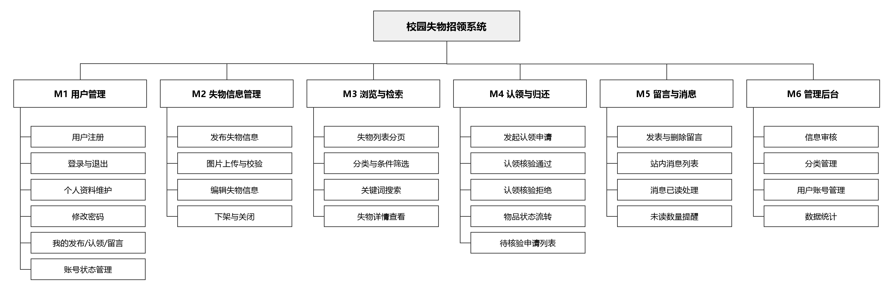

图 3-1 系统功能模块结构图

| 模块 | 功能点 | 对应需求 |
|---|---|---|
| M1 用户管理 | 注册、登录、退出、个人资料、修改密码、我的发布/认领/留言、账号状态管理 | FR-01～FR-04 |
| M2 失物信息管理 | 发布信息、图片上传、编辑信息、关闭信息 | FR-05～FR-07、FR-15 |
| M3 浏览与检索 | 列表查询、关键词搜索与筛选、信息详情 | FR-08～FR-11 |
| M4 认领与归还 | 状态机、发起认领、核验通过、核验拒绝、待核验申请列表 | FR-12～FR-15 |
| M5 留言与消息 | 发表留言、删除留言、发送消息、消息列表与已读 | FR-16、FR-17 |
| M6 管理后台 | 信息审核、分类管理、用户管理、数据统计 | FR-18～FR-20 |

### 3.2 后端分层程序结构

后端采用表现层、业务层、数据访问层三层结构，并由公共支撑组件横向支撑，结构如图 3-2。

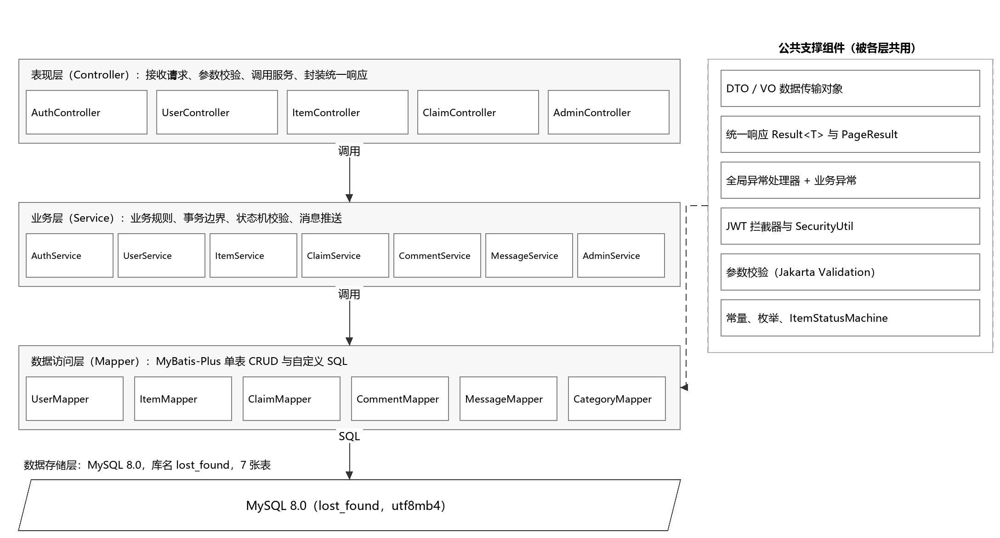

图 3-2 后端分层程序结构图

| 层次 | 组成 | 职责 | 禁止事项 |
|---|---|---|---|
| 表现层 | 5 个 Controller | 路由映射、DTO 绑定与校验、调用 Service、返回 Result | 不直接访问 Mapper，不写业务分支 |
| 业务层 | 7 个 Service 接口及其实现类 | 业务规则、状态机、事务、消息推送、VO 组装 | 不处理 HTTP 对象，不拼接前端展示文本以外的格式 |
| 数据访问层 | 6 个 Mapper | 单表 CRUD（BaseMapper）与自定义 SQL（关联查询、统计、条件更新） | 不在 SQL 中写业务判断逻辑 |
| 数据存储层 | MySQL 8.0（lost_found） | 7 张表的数据持久化 | — |

调用规则：Controller → Service → Mapper 单向调用；Service 之间允许同层调用（如 `ClaimService` 调用 `MessageService.push()`），但禁止反向依赖；跨模块的数据读取通过各自 Service 的查询方法完成，不直接使用对方的 Mapper。

### 3.3 前端页面路由与组件结构

前端分为前台与后台两套布局，共用公共组件库，结构如图 3-3。

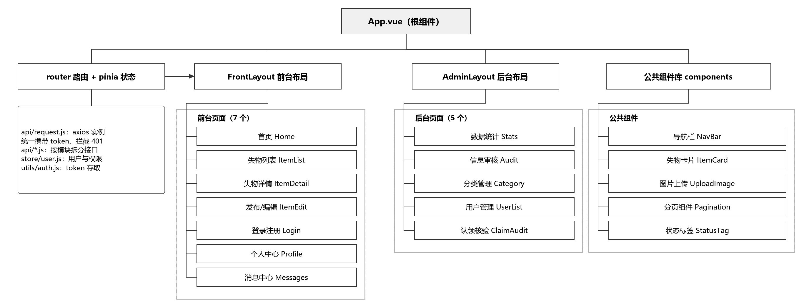

图 3-3 前端页面路由与组件结构图

| 路由 | 页面组件 | 布局 | 权限 | 主要接口 |
|---|---|---|---|---|
| `/` | views/front/Home.vue | FrontLayout | 公开 | GET /api/items、GET /api/categories |
| `/items` | views/front/ItemList.vue | FrontLayout | 公开 | GET /api/items |
| `/items/:id` | views/front/ItemDetail.vue | FrontLayout | 公开 | GET /api/items/{id}、POST /api/claims、POST /api/comments |
| `/items/new` | views/front/ItemEdit.vue | FrontLayout | 登录 | POST /api/items、POST /api/upload/image |
| `/items/:id/edit` | views/front/ItemEdit.vue | FrontLayout | 发布者 | PUT /api/items/{id} |
| `/login` | views/front/Login.vue | 无布局 | 公开 | POST /api/auth/login、POST /api/auth/register |
| `/profile` | views/front/Profile.vue | FrontLayout | 登录 | GET/PUT /api/user/profile、PUT /api/user/password、GET /api/user/items、/claims、/comments |
| `/messages` | views/front/Messages.vue | FrontLayout | 登录 | GET /api/messages、PUT /api/messages/{id}/read |
| `/admin` | views/admin/Stats.vue | AdminLayout | 管理员 | GET /api/admin/stats |
| `/admin/audit` | views/admin/Audit.vue | AdminLayout | 管理员 | GET /api/admin/items/audit、PUT /api/admin/items/{id}/audit |
| `/admin/claims` | views/admin/ClaimAudit.vue | AdminLayout | 管理员 | GET /api/claims、PUT /api/claims/{id}/approve、/reject |
| `/admin/categories` | views/admin/Category.vue | AdminLayout | 管理员 | GET/POST/PUT/DELETE /api/admin/categories |
| `/admin/users` | views/admin/UserList.vue | AdminLayout | 管理员 | GET /api/admin/users、PUT /api/admin/users/{id}/status |

路由守卫规则：`meta.requiresAuth` 为真的路由在无 token 时跳转 `/login?redirect=原路径`；`meta.requiresAdmin` 为真的路由在 `role<>1` 时跳转首页并提示"无访问权限"；已登录用户访问 `/login` 时直接跳转首页。

### 3.4 程序单元清单

| 编号 | 名称 | 所属模块 | 主要接口 | 需求 |
|---|---|---|---|---|
| U1.1 | 学生注册 | M1 | POST /api/auth/register | FR-01 |
| U1.2 | 登录与令牌签发 | M1 | POST /api/auth/login | FR-02 |
| U1.3 | 退出登录 | M1 | POST /api/auth/logout | FR-02 |
| U1.4 | 个人资料维护 | M1 | GET/PUT /api/user/profile | FR-03 |
| U1.5 | 修改密码 | M1 | PUT /api/user/password | FR-03 |
| U1.6 | 我的发布/认领/留言 | M1 | GET /api/user/items、/claims、/comments | FR-03 |
| U1.7 | 账号状态管理 | M1 | GET /api/admin/users、PUT /api/admin/users/{id}/status | FR-04 |
| U2.1 | 发布失物信息 | M2 | POST /api/items | FR-05 |
| U2.2 | 图片上传与校验 | M2 | POST /api/upload/image | FR-07 |
| U2.3 | 编辑失物信息 | M2 | PUT /api/items/{id} | FR-06 |
| U2.4 | 关闭信息（下架） | M2 | PUT /api/items/{id}/close | FR-15 |
| U3.1 | 列表查询与分页 | M3 | GET /api/items | FR-08、FR-09 |
| U3.2 | 关键词搜索与排序 | M3 | GET /api/items?keyword= | FR-10 |
| U3.3 | 信息详情展示 | M3 | GET /api/items/{id} | FR-11 |
| U4.1 | 物品与认领状态机 | M4 | 被 U2.4、U4.3、U4.4 复用 | FR-12 |
| U4.2 | 发起认领申请 | M4 | POST /api/claims | FR-13 |
| U4.3 | 认领核验通过 | M4 | PUT /api/claims/{id}/approve | FR-14 |
| U4.4 | 认领核验拒绝 | M4 | PUT /api/claims/{id}/reject | FR-14 |
| U4.5 | 待核验申请列表 | M4 | GET /api/claims | FR-14 |
| U5.1 | 发表留言 | M5 | POST /api/comments | FR-16 |
| U5.2 | 删除留言 | M5 | DELETE /api/comments/{id} | FR-16 |
| U5.3 | 消息推送 | M5 | 内部方法 MessageService.push | FR-17 |
| U5.4 | 消息列表、已读与未读数 | M5 | GET /api/messages、PUT /{id}/read、GET /unread-count | FR-17 |
| U6.1 | 信息审核 | M6 | GET /api/admin/items/audit、PUT /{id}/audit | FR-18 |
| U6.2 | 分类管理 | M6 | /api/admin/categories 系列 | FR-19 |
| U6.3 | 用户列表查询 | M6 | GET /api/admin/users | FR-04 |
| U6.4 | 数据统计 | M6 | GET /api/admin/stats | FR-20 |

### 3.5 程序单元调用关系

| 调用方 | 被调用方 | 调用目的 |
|---|---|---|
| AuthController | AuthService | 注册、登录、退出 |
| UserController | UserService、MessageService | 个人资料、修改密码、我的发布/认领/留言、消息列表 |
| ItemController | ItemService、CommentService | 发布、编辑、关闭、列表、详情、发表与删除留言 |
| ClaimController | ClaimService | 发起认领、核验通过、核验拒绝、核验列表 |
| AdminController | AdminService | 信息审核、分类管理、用户管理、数据统计 |
| ItemService | ItemStatusMachine、MessageService | 关闭或编辑时校验状态、推送消息 |
| ClaimService | ItemStatusMachine、ItemMapper、MessageService | 核验时条件更新、推送结果 |
| CommentService | MessageService | 留言后提醒发布者 |
| AdminService | MessageService | 审核通过/驳回后通知发布者 |
| 全部 Service | 各 Mapper | 数据读写 |
| DataInitializer | UserMapper | 启动时幂等创建管理员账号 |

说明三点：一是留言与消息未单独设 Controller，前者并入 `ItemController`（路径 `/api/comments`），后者并入 `UserController`（路径 `/api/messages`），以保持 Controller 数量与 M6 后台职责分离一致；二是图片上传不设独立 Service，由 `ItemService` 在发布/编辑时调用工具类 `FileUtil` 完成校验与落盘，接口 `POST /api/upload/image` 由 `ItemController` 承载；三是审核、分类、用户、统计四类后台操作合并进 `AdminService`，不再拆分为 Audit/Category/UserAdmin/Stats 四个服务，避免 Service 层碎片化。

### 3.6 设计类图与类职责

需求分析阶段的类图是**分析级**的：它给出学生、管理员、失物信息、图片、分类、认领申请、留言、站内消息 8 个实体类与 4 个枚举，刻画问题领域的概念与静态关系（继承、聚合、多重性），但不含任何实现类。本节在其之上给出**实现级**设计类图，补齐 Controller、Service、Mapper 与公共支撑类，并明确分层依赖方向，如图 3-4。图中每个类框按「名称 / 成员」两段分隔；LostItem 与 ItemImage 为 1 : N 组合，组合关系在实体层体现，图中从略。

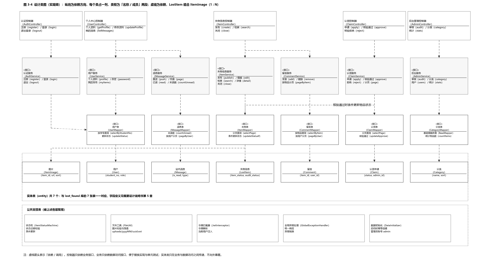

图 3-4 设计类图（实现级）

图中虚线箭头表示依赖：Controller 只依赖 Service 接口，Service 只依赖 Mapper 接口与公共支撑类，Mapper 通过泛型绑定对应的 entity；Service 接口的实现类 ServiceImpl 位于 service.impl 包、与接口同列对应。各类的职责与约定见表 3-5。

表 3-5 业务接口职责与实现约定

| 业务接口 | 职责 | 关键约定 |
|---|---|---|
| AuthService | 注册唯一性校验、BCrypt 加密、登录验密与签发 JWT | 接口 + `AuthServiceImpl`（`@Service`）；只读方法 `@Transactional(readOnly=true)` |
| UserService | 资料读写、改密、我的三类列表、用户列表与状态变更 | 返回 VO，不返回 entity 与密码字段 |
| ItemService | 发布、编辑、关闭、列表检索、详情、审核、图片落盘 | 状态变更一律经 `ItemStatusMachine` |
| ClaimService | 发起认领、核验通过/拒绝、核验列表 | 核验通过用条件更新 + 事务，失败回滚 |
| CommentService | 留言发表、删除、按信息分页 | 删除校验作者本人或管理员 |
| MessageService | 消息推送、列表、已读、未读数 | `push()` 为内部方法，供其他 Service 调用 |
| AdminService | 审核、分类增删改查、用户列表、统计聚合 | 分类删除前校验是否被引用 |

其余三层的职责已在图 3-4 中逐类给出，此处只说明它们的划分口径：**控制类** 5 个（AuthController、UserController、ItemController、ClaimController、AdminController）与七个业务接口一一对应，只做参数绑定、`@Validated` 校验与结果封装，当前用户一律从 `SecurityUtil` 取、不接受前端传入的 userId；**数据访问** 6 个 Mapper 均 `extends BaseMapper<T>`，仅"按学号查询、条件更新状态、关联查询昵称"等单表条件查询写成自定义 SQL；**实体类** 7 个与数据库 7 张表一一对应，只用 `@TableName` 标注映射、不写业务方法；**支撑类** 5 组（ItemStatusMachine、FileUtil、JwtInterceptor/SecurityUtil、GlobalExceptionHandler/Result、DataInitializer）被各层复用，其中状态机集中了全部合法迁移与副作用登记，非法迁移统一抛业务异常（物品 2003、认领 3002）。

三条实现约定：一是**接口与实现分离**，Service 一律为接口，实现类命名为 `XxxServiceImpl` 并标注 `@Service`、`@Transactional`（只读方法用 `readOnly=true`）；二是**依赖只朝下**，Controller 不得注入 Mapper，Service 不得注入 Controller，跨模块读取走对方 Service 的查询方法；三是**对外不暴露 entity**，Controller 的入参为 DTO、出参为 VO 或 `Result<T>`，entity 只在 Service 与 Mapper 之间传递。

## 4 模块详细设计

本章按程序单元逐个给出详细设计。每个单元的说明模板固定为五项：**功能说明**（做什么、边界在哪）、**输入与输出**（字段与来源）、**处理流程**（步骤化描述，配套流程图）、**核心伪代码**（关键判断与顺序）、**异常分支**（触发条件与返回码）；各单元的测试要点不逐节重复，集中列在 4.7 的表 4-7。伪代码采用 Java 风格，只保留决定正确性的语句，省略 DTO 赋值与日志；与本章其他单元重复的写法只在首次出现的单元展开，后续单元只说明差异。

### 4.1 M1 用户管理模块

本模块负责账号的建立、认证与个人数据维护。三条通行规则：一是手机号与学号唯一性由数据库唯一索引与业务校验双重保证；二是密码只以 BCrypt 摘要形式存在，任何接口都不返回密码字段；三是登录状态由无状态 JWT 承载，服务端不保存会话。

#### 4.1.1 U1.1 学生注册

**功能说明**：游客提交学号、密码、昵称、手机号完成注册，注册成功后账号角色固定为学生（role=0）、状态正常（status=0），并可直接登录。注册不涉及邮箱验证与人工审核。

**输入与输出**：

| 项 | 字段 | 说明 |
|---|---|---|
| 输入 | studentNo | 学号，6~12 位数字，全局唯一 |
| 输入 | password | 明文密码，6~20 位，需二次确认（前端校验） |
| 输入 | nickname | 昵称，2~12 个字符，不含空白 |
| 输入 | phone | 手机号，11 位，`^1[3-9]\d{9}$` |
| 输出 | Result\<Void\> | 成功 code=200；学号已存在返回 1002 |

**处理流程**（图 4-1）：接收请求并完成 Bean Validation 格式校验 → 按学号查询用户表 → 若已存在则返回 1002 → 对密码执行 BCrypt 加密（cost=10）→ 组装 User 实体（role=0、status=0、createdAt=当前时间）→ 插入数据库 → 返回成功。唯一索引冲突（DuplicateKeyException）作为并发兜底同样转换为 1002。

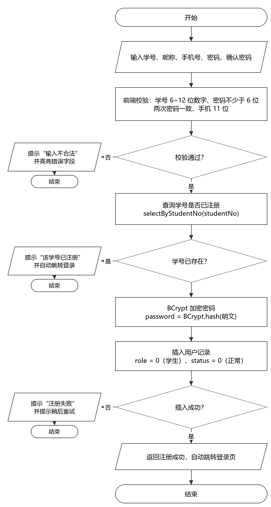

图 4-1 注册流程图

**核心伪代码**：

```java
public void register(RegisterDTO dto) {
    if (userMapper.selectCount(new LambdaQueryWrapper<User>()
            .eq(User::getStudentNo, dto.getStudentNo())) > 0) {
        throw new BusinessException(ResultCode.USER_EXISTS);       // 1002
    }
    User user = new User();
    user.setStudentNo(dto.getStudentNo());
    user.setPassword(passwordEncoder.encode(dto.getPassword()));   // BCrypt cost=10
    user.setNickname(dto.getNickname());
    user.setPhone(dto.getPhone());
    user.setRole(RoleEnum.STUDENT.getCode());                      // 0
    user.setStatus(UserStatusEnum.NORMAL.getCode());               // 0
    user.setCreatedAt(LocalDateTime.now());
    try {
        userMapper.insert(user);
    } catch (DuplicateKeyException e) {
        throw new BusinessException(ResultCode.USER_EXISTS);       // 并发兜底
    }
}
```

**异常分支**：

| 条件 | 返回码 | HTTP | 前端提示 |
|---|---|---|---|
| 学号格式非法 | 1001 | 400 | 学号须为 6~12 位数字 |
| 学号已注册 | 1002 | 400 | 该学号已注册，请直接登录 |
| 密码长度不符 | 1001 | 400 | 密码长度 6~20 位 |
| 手机号格式非法 | 1001 | 400 | 请输入正确的手机号 |

#### 4.1.2 U1.2 登录与令牌签发

**功能说明**：学生或管理员凭学号与密码登录，校验通过后签发 JWT，前端保存 token 并携带于后续请求的 `Authorization: Bearer <token>` 头。登录失败一律返回同一提示，避免暴露"账号是否存在"。

**输入与输出**：

| 项 | 字段 | 说明 |
|---|---|---|
| 输入 | studentNo、password | 学号与明文密码 |
| 输出 | token、user{id, nickname, role, avatar} | JWT 有效期 12 小时，claims 含 uid 与 role |

**处理流程**（图 4-2）：校验参数非空 → 按学号查询用户 → 用户不存在、密码不匹配两种情况都返回 1003 → 判断 status，被禁用返回 1004 → 使用 `JwtUtil.generate(uid, role)` 签发令牌 → 组装 LoginVO 返回。

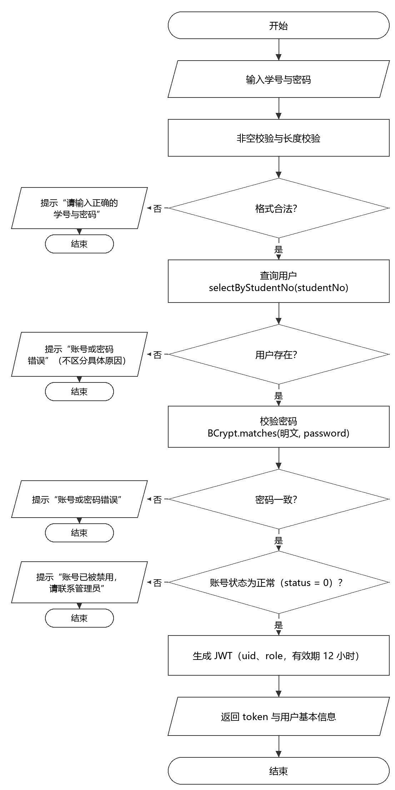

图 4-2 登录流程图

**核心伪代码**：

```java
public LoginVO login(LoginDTO dto) {
    User user = userMapper.selectOne(new LambdaQueryWrapper<User>()
            .eq(User::getStudentNo, dto.getStudentNo()));
    if (user == null || !passwordEncoder.matches(dto.getPassword(), user.getPassword())) {
        throw new BusinessException(ResultCode.LOGIN_FAILED);      // 1003，不区分原因
    }
    if (user.getStatus() == UserStatusEnum.DISABLED.getCode()) {
        throw new BusinessException(ResultCode.USER_DISABLED);      // 1004
    }
    String token = jwtUtil.generate(user.getId(), user.getRole());  // HS256, 12h
    return LoginVO.of(token, user);                                 // 不返回 password
}
```

**异常分支**：

| 条件 | 返回码 | HTTP | 说明 |
|---|---|---|---|
| 参数为空 | 1001 | 400 | 学号与密码不能为空 |
| 账号不存在或密码错误 | 1003 | 400 | 统一提示"学号或密码错误" |
| 账号被禁用 | 1004 | 403 | "账号已被禁用，请联系管理员" |
| 令牌过期（后续请求） | 2001 | 401 | 前端清除 token 并跳转登录 |

#### 4.1.3 U1.3 退出登录

**功能说明**：无状态令牌下退出由前端删除本地 token 完成，后端接口仅用于记录日志与（可选）将令牌加入短期黑名单。本系统采用"前端清除 + 服务端记录"的轻量方案，不维护服务端会话。

**输入与输出**：输入为请求头中的 token；输出 `Result<Void>`。

**处理流程**：拦截器解析 token 得到 uid → 记录退出日志 → 返回成功 → 前端清除 localStorage 中的 token 与用户信息、清空 Pinia 中的用户状态、跳转首页。

**核心伪代码**：

```java
public void logout() {
    Long uid = SecurityUtil.getUserId();     // 由拦截器写入 ThreadLocal
    log.info("user logout, uid={}", uid);
    // 无状态令牌：不写服务端会话，前端清除即可
}
```

**异常分支**：token 缺失或非法时拦截器已拦截（2001/401），方法体不会执行。

#### 4.1.4 U1.4 个人资料维护

**功能说明**：查看与修改本人昵称、手机号。学号与角色不可修改；修改手机号需重新校验格式。

**输入与输出**：

| 项 | 字段 | 说明 |
|---|---|---|
| 输入（GET） | — | 从 token 取 uid |
| 输出（GET） | id、studentNo、nickname、phone、role、createdAt | UserVO，不含密码 |
| 输入（PUT） | nickname、phone | 均可选，为空则不修改 |
| 输出（PUT） | 更新后的 UserVO | — |

**处理流程**：GET 按 uid 查询并转 VO → PUT 先查询原记录（不存在返回 2004）→ 逐字段判断非空后覆盖 → 更新 `updatedAt` 由数据库 `ON UPDATE` 处理 → 返回最新 VO。手机号被其他账号占用时不拦截（手机号非唯一键）。

**核心伪代码**：

```java
@Transactional
public UserVO updateProfile(ProfileDTO dto) {
    Long uid = SecurityUtil.getUserId();
    User user = userMapper.selectById(uid);
    if (user == null) throw new BusinessException(ResultCode.USER_NOT_FOUND);  // 2004
    if (StringUtils.hasText(dto.getNickname())) user.setNickname(dto.getNickname());
    if (StringUtils.hasText(dto.getPhone()))    user.setPhone(dto.getPhone());
    userMapper.updateById(user);
    return UserVO.of(userMapper.selectById(uid));
}
```

**异常分支**：用户不存在返回 2004；昵称超长或含控制字符返回 1001。

#### 4.1.5 U1.5 修改密码

**功能说明**：已登录用户凭原密码设置新密码，成功后需重新登录（前端主动清除 token）。

**输入与输出**：输入 oldPassword、newPassword（6~20 位，且不得与原密码相同）；输出 `Result<Void>`。

**处理流程**：按 uid 查询用户 → `passwordEncoder.matches(oldPassword, 库中摘要)` 不通过返回 1005 → 校验新旧密码不相同，相同返回 1001 → 加密新密码并条件更新（`WHERE id=? AND password=?`，以旧摘要为乐观条件，防止并发改密覆盖）→ 影响行数为 0 返回 1005 → 成功。

**核心伪代码**：

```java
@Transactional
public void changePassword(PasswordDTO dto) {
    User user = userMapper.selectById(SecurityUtil.getUserId());
    if (!passwordEncoder.matches(dto.getOldPassword(), user.getPassword())) {
        throw new BusinessException(ResultCode.OLD_PASSWORD_ERROR);       // 1005
    }
    String newHash = passwordEncoder.encode(dto.getNewPassword());
    int rows = userMapper.update(null, new LambdaUpdateWrapper<User>()
            .eq(User::getId, user.getId())
            .eq(User::getPassword, user.getPassword())                     // 乐观条件
            .set(User::getPassword, newHash));
    if (rows != 1) throw new BusinessException(ResultCode.OLD_PASSWORD_ERROR);
}
```

**异常分支**：原密码错误 1005；新密码与原密码相同 1001；新密码长度不符 1001。

#### 4.1.6 U1.6 我的发布 / 我的认领 / 我的留言

**功能说明**：个人中心三个分页列表，分别返回本人发布的失物信息、本人提交的认领申请、本人在他人信息下的留言，均按创建时间倒序。

**输入与输出**：输入统一为 `page`（默认 1）、`size`（默认 12）、可选 `status` 过滤；输出 `PageResult<ItemListVO | ClaimVO | CommentVO>`。

**处理流程**：三个方法共用 `PageQuery` 参数 → 分别按 `user_id = 当前用户`、`applicant_id = 当前用户`、`comment.user_id = 当前用户` 构造分页查询 → 认领列表需 join lost_item 取标题与状态 → 留言列表需 join lost_item 取标题 → 组装 VO 返回。列表项不返回长描述，只返回摘要。

**核心伪代码**：

```java
public PageResult<ClaimVO> myClaims(PageQuery q) {
    Page<Claim> page = new Page<>(q.getPage(), q.getSize());
    return PageResult.of(claimMapper.selectMyClaims(page, SecurityUtil.getUserId()));
}
```

```xml
<!-- ClaimMapper.selectMyClaims：只取申请与关联信息标题 -->
SELECT c.id, c.item_id, i.title, i.type, c.status, c.reply, c.created_at
FROM claim c JOIN lost_item i ON i.id = c.item_id
WHERE c.applicant_id = #{uid}
ORDER BY c.created_at DESC
```

**异常分支**：page 小于 1 时纠正为 1；size 超过 50 时截断为 50，避免大页查询拖慢响应。

#### 4.1.7 U1.7 账号状态管理（管理员）

**功能说明**：管理员查看全部用户（按角色、状态、学号或昵称筛选）并启用/禁用账号。管理员不能禁用自己，也不能禁用其他管理员账号。

**输入与输出**：

| 项 | 字段 | 说明 |
|---|---|---|
| 输入（GET） | page、size、role、status、keyword | keyword 匹配学号或昵称 |
| 输出（GET） | PageResult\<UserVO\> | 不含密码 |
| 输入（PUT） | status（0 正常 / 1 禁用） | 目标用户 id 在路径 |
| 输出（PUT） | Result\<Void\> | — |

**处理流程**：GET 按条件分页查询（Mapper 动态 SQL）→ 转 VO。PUT 依次校验：目标用户存在（否则 2004）→ 目标用户不是当前管理员（否则 2002）→ 目标用户角色为 0（否则 2002）→ `UPDATE user SET status=? WHERE id=?` → 成功后返回。禁用后该用户已签发的 token 在下一次请求时被拦截器查出 status=1 而拒绝（1004）。

**核心伪代码**：

```java
@Transactional
public void updateStatus(Long userId, Integer status) {
    User target = userMapper.selectById(userId);
    if (target == null) throw new BusinessException(ResultCode.USER_NOT_FOUND);
    if (target.getId().equals(SecurityUtil.getUserId())
            || target.getRole() == RoleEnum.ADMIN.getCode()) {
        throw new BusinessException(ResultCode.NO_PERMISSION);        // 2002
    }
    userMapper.update(null, new LambdaUpdateWrapper<User>()
            .eq(User::getId, userId).set(User::getStatus, status));
}
```

**异常分支**：非管理员访问 2002；目标不存在 2004；操作自己或管理员 2002；status 非 0/1 返回 1001。

### 4.2 M2 失物信息管理模块

本模块负责失物信息的创建、维护与下架。核心约束：新发布或审核驳回后重新提交的信息一律进入"待审核"（audit_status=0），只有审核通过的信息才对外可见；信息一旦进入"已完成"（item_status=2）不再允许编辑与关闭。

#### 4.2.1 U2.1 发布失物信息

**功能说明**：登录用户发布一条寻物（type=0）或拾物（type=1）信息，可附带最多 3 张图片（图片先经 U2.2 上传得到 URL，再随表单一并提交）。发布后状态为"待审核"，不进入公开列表。

**输入与输出**：

| 项 | 字段 | 校验 |
|---|---|---|
| 输入 | type | 0 寻物 / 1 拾物，必填 |
| 输入 | title | 1~30 字，必填 |
| 输入 | description | 10~500 字，必填 |
| 输入 | categoryId | 必填，须存在于 category 表 |
| 输入 | happenTime | 不晚于当前时间 |
| 输入 | happenPlace | 1~60 字，必填 |
| 输入 | contact | 联系方式，1~30 字，必填 |
| 输入 | images | 图片 URL 数组，0~3 个 |
| 输出 | id | 新信息主键 |

**处理流程**（图 4-3）：格式校验 → 校验分类存在（否则 5003）→ 校验 images 数量 ≤3（否则 4004）→ 组装 LostItem（auditStatus=0、itemStatus=0）→ 插入主表 → 按数组顺序插入 item_image（sort 递增）→ 返回 id。图片表与主表同一事务，避免出现无图信息或孤儿图片。

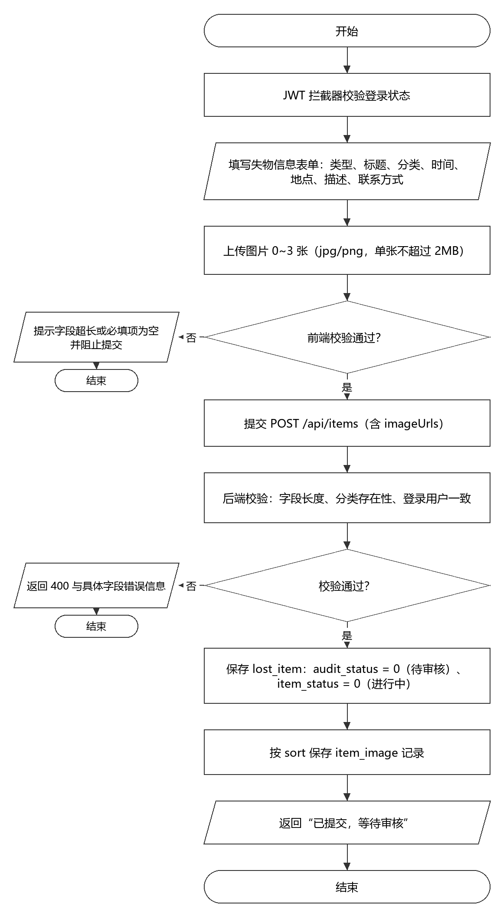

图 4-3 发布失物信息流程图

**核心伪代码**：

```java
@Transactional
public Long create(ItemSaveDTO dto) {
    if (categoryMapper.selectById(dto.getCategoryId()) == null) {
        throw new BusinessException(ResultCode.CATEGORY_NOT_FOUND);       // 5003
    }
    if (dto.getImages() != null && dto.getImages().size() > 3) {
        throw new BusinessException(ResultCode.IMAGE_TOO_MANY);           // 4004
    }
    LostItem item = new LostItem();
    item.setUserId(SecurityUtil.getUserId());
    item.setType(dto.getType());
    item.setTitle(dto.getTitle());
    item.setDescription(dto.getDescription());
    item.setCategoryId(dto.getCategoryId());
    item.setHappenTime(dto.getHappenTime());
    item.setHappenPlace(dto.getHappenPlace());
    item.setContact(dto.getContact());
    item.setAuditStatus(AuditStatusEnum.PENDING.getCode());               // 0
    item.setItemStatus(ItemStatusEnum.ONGOING.getCode());                 // 0
    item.setCreatedAt(LocalDateTime.now());
    itemMapper.insert(item);
    int sort = 0;
    for (String url : dto.getImages() == null ? List.<String>of() : dto.getImages()) {
        itemImageMapper.insert(new ItemImage(item.getId(), url, sort++));
    }
    return item.getId();
}
```

**异常分支**：

| 条件 | 返回码 | 说明 |
|---|---|---|
| 标题空或超 30 字 | 1001 | 参数校验统一码 |
| 描述少于 10 字 | 1001 | 防止无意义信息 |
| 分类不存在 | 5003 | 分类可能已被删除 |
| 图片超过 3 张 | 4004 | 与前端 UploadImage 的 limit 一致 |
| 发生时间晚于当前 | 1001 | — |

#### 4.2.2 U2.2 图片上传与校验

**功能说明**：接收单个图片文件，校验类型、大小与当日数量，落盘到 `{user.dir}/uploads/yyyyMM/`，返回可直接访问的相对 URL。该单元被发布、编辑、头像上传复用。

**输入与输出**：输入 `MultipartFile file`；输出 `{url}`，形如 `/uploads/202611/9f3c...e1.jpg`。

**处理流程**（图 4-4）：判断文件是否为空（4001）→ 判断大小 ≤ 2MB（4002）→ 读取扩展名并限定 jpg/jpeg/png，同时校验 MIME 与文件头魔数（4003）→ 生成"年月/uuid.ext"路径并创建目录 → 写入磁盘 → 返回 URL。文件名为 UUID，不保留原始文件名，避免路径穿越与中文名乱码。

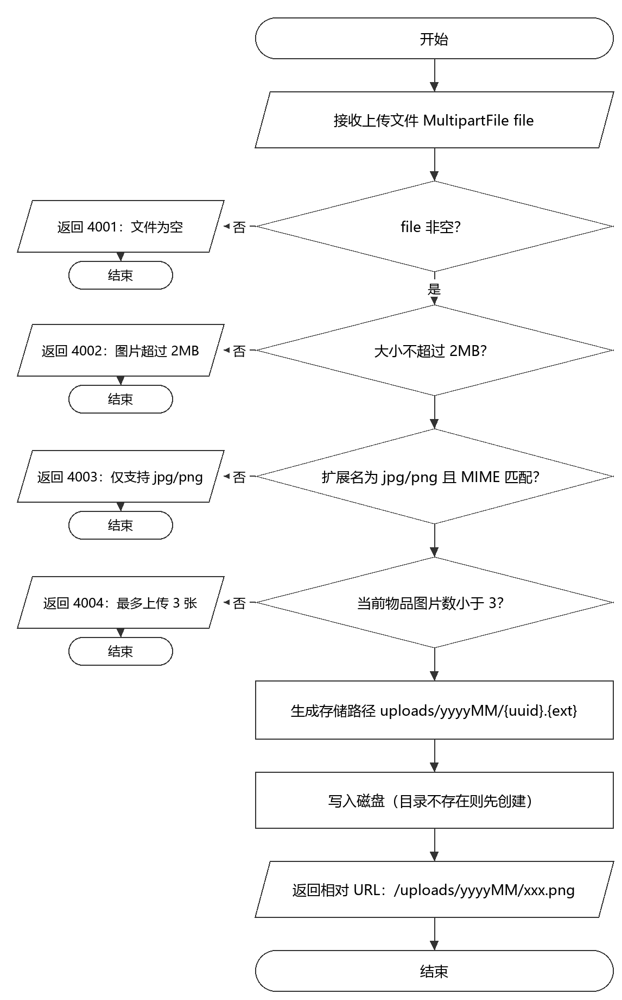

图 4-4 图片上传校验流程图

**核心伪代码**：

```java
public String upload(MultipartFile file) {
    if (file == null || file.isEmpty())      throw new BusinessException(ResultCode.FILE_EMPTY);      // 4001
    if (file.getSize() > 2 * 1024 * 1024)    throw new BusinessException(ResultCode.FILE_TOO_LARGE);  // 4002
    String ext = FileUtil.extOf(file.getOriginalFilename());   // 不含点，小写
    if (!Set.of("jpg", "jpeg", "png").contains(ext)
            || !FileUtil.magicMatches(file, ext)) {            // 文件头校验
        throw new BusinessException(ResultCode.FILE_TYPE_ERROR);                                      // 4003
    }
    String month = DateTimeFormatter.ofPattern("yyyyMM").format(LocalDate.now());
    String name  = UUID.randomUUID().toString().replace("-", "") + "." + ext;
    Path dir = Paths.get(System.getProperty("user.dir"), "uploads", month);
    Files.createDirectories(dir);
    file.transferTo(dir.resolve(name).toFile());
    return "/uploads/" + month + "/" + name;
}
```

**异常分支**：

| 条件 | 返回码 | HTTP | 说明 |
|---|---|---|---|
| 文件为空 | 4001 | 400 | 未选择文件 |
| 超过 2MB | 4002 | 400 | 前端亦做一次预校验 |
| 扩展名/MIME/魔数不符 | 4003 | 400 | 改扩展名的伪装文件被拦截 |
| 磁盘写入失败 | 9999 | 500 | 记录堆栈，提示稍后重试 |

#### 4.2.3 U2.3 编辑失物信息

**功能说明**：发布者本人修改自己未完成的信息。修改标题、描述、分类、地点、时间、联系方式与图片；修改后信息回到"待审核"并重新进入审核队列（已审核通过的信息被修改后需管理员再次确认，防止先过审后篡改）。

**输入与输出**：输入路径 id 与 ItemSaveDTO（同 U2.1）；输出 `Result<Void>`。

**处理流程**：查询信息（不存在返回 2004）→ 校验当前用户是否为发布者或管理员（否则 2002）→ 校验 item_status 不为"已完成"（否则 2003）→ 覆盖可编辑字段、将 audit_status 重置为 0、清空 reject_reason → 更新主表 → 若传入 images 则先删后插（整体替换）→ 返回成功。

**与 U2.1 的差异**：DTO 与字段校验、分类存在性、图片数量校验完全复用 U2.1，不重复描述；本单元比发布多出三处约束和一处特殊写法，见表 4-6。

表 4-6 U2.3 相对 U2.1 的差异

| 差异点 | 处理方式 | 失败返回 |
|---|---|---|
| 记录归属 | 查询后校验为发布者本人或管理员 | 2002 |
| 可编辑前置 | `item_status = 2`（已完成）不允许修改 | 2003 |
| 审核状态 | 覆盖字段后 `audit_status` 重置为 0、`reject_reason` 清空 | — |
| 图片 | `images != null` 时先删后插整体替换；`null` 表示不动图 | 4004 |

**核心伪代码**（只列与发布不同的部分）：

```java
@Transactional
public void update(Long id, ItemSaveDTO dto) {           // 字段校验同 U2.1
    LostItem item = requireEditable(id);                 // 2004 / 2002 / 2003
    item.setTitle(dto.getTitle()); /* 描述、分类、时间、地点、联系方式逐项覆盖 */
    item.setAuditStatus(AuditStatusEnum.PENDING.getCode());
    item.setRejectReason(null);
    itemMapper.updateById(item);
    if (dto.getImages() != null) {                       // 整体替换
        itemImageMapper.delete(Wrappers.<ItemImage>lambdaQuery().eq(ItemImage::getItemId, id));
        int sort = 0;
        for (String url : dto.getImages()) itemImageMapper.insert(new ItemImage(id, url, sort++));
    }
}
```

**异常分支**：信息不存在 2004；非本人且非管理员 2002；已完成 2003；分类不存在 5003；图片超 3 张 4004。

#### 4.2.4 U2.4 关闭信息（下架）

**功能说明**：发布者或管理员将信息下架。下架后信息不再出现在公开列表与详情页（详情返回 404 语义的 2004），但数据保留以备核查。已完成的信息不允许关闭。

**输入与输出**：输入路径 id 与可选的 closeReason；输出 `Result<Void>`。

**处理流程**：查询信息（2004）→ 权限校验（发布者或管理员，2002）→ 调用 `ItemStatusMachine.checkClose(from)`：仅"进行中(0)"与"处理中(1)"可关闭，否则 2003 → 条件更新 `UPDATE lost_item SET item_status=3 WHERE id=? AND item_status=?`，影响行数不为 1 时抛 2003（并发已被他人处理）→ 若存在待核验认领，将其一并置为拒绝并写明原因 → 给相关申请人与发布者推送消息 → 返回成功。

**核心伪代码**：

```java
@Transactional
public void close(Long id) {
    LostItem item = itemMapper.selectById(id);
    if (item == null) throw new BusinessException(ResultCode.ITEM_NOT_FOUND);
    if (!item.getUserId().equals(SecurityUtil.getUserId()) && !SecurityUtil.isAdmin()) {
        throw new BusinessException(ResultCode.ITEM_NOT_OWNER);
    }
    ItemStatusMachine.checkClose(item.getItemStatus());                       // 0/1 才允许
    int rows = itemMapper.update(null, new LambdaUpdateWrapper<LostItem>()
            .eq(LostItem::getId, id)
            .eq(LostItem::getItemStatus, item.getItemStatus())                // 条件更新
            .set(LostItem::getItemStatus, ItemStatusEnum.CLOSED.getCode()));  // 3
    if (rows != 1) throw new BusinessException(ResultCode.ITEM_STATUS_ILLEGAL);
    claimMapper.rejectPendingByItem(id, "信息已被发布者关闭");
    messageService.push(item.getUserId(), MessageTypeEnum.SYSTEM, "你发布的信息已关闭");
}
```

**异常分支**：信息不存在 2004；非本人 2002；已完成 2003；并发关闭导致影响行数 0 返回 2003。

### 4.3 M3 浏览与检索模块

本模块面向全部访客（含未登录），是系统访问量最大的部分。三条性能约束贯穿设计：查询必须走索引；列表不返回大字段（description）；详情页的写操作（浏览量）不影响主流程。

#### 4.3.1 U3.1 列表查询与分页

**功能说明**：按类型（寻物/拾物）、分类、状态筛选，分页返回审核通过的信息卡片数据。未登录与登录用户看到的数据一致，仅联系方式字段在详情页做掩码。

**输入与输出**：

| 项 | 字段 | 说明 |
|---|---|---|
| 输入 | page、size | 默认 1、12，size 上限 50 |
| 输入 | type | 0/1，可空表示全部 |
| 输入 | categoryId | 可空 |
| 输入 | itemStatus | 可空，默认只查 0/1（进行中、处理中） |
| 输出 | total、records[] | 每条含 id、type、title、coverImage、categoryName、happenPlace、happenTime、itemStatus、createdAt |

**处理流程**（图 4-5）：规范化分页参数 → 组装查询条件（固定 `audit_status=1`）→ 分页查询主表并按 `created_at DESC` 排序 → 批量查询封面图（取 sort 最小的一张，避免 N+1）→ 组装 VO 返回。

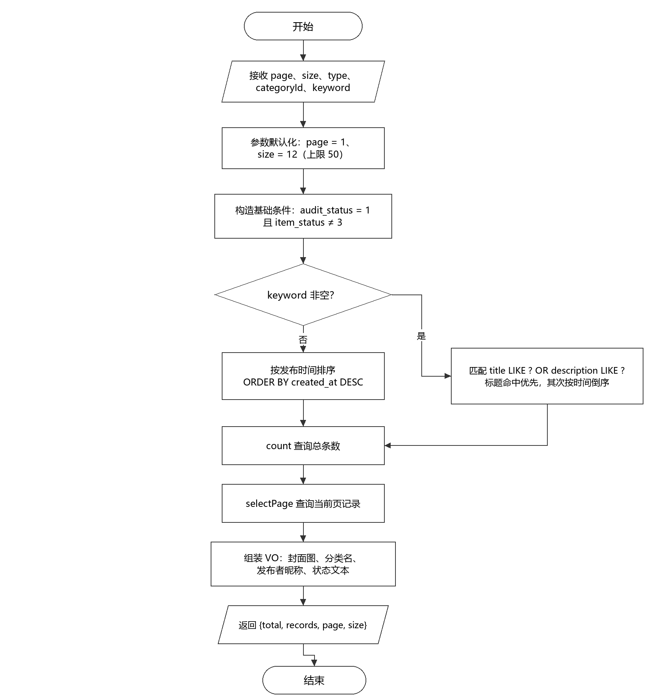

图 4-5 列表检索流程图

**核心伪代码**：

```java
public PageResult<ItemListVO> page(ItemQuery q) {
    Page<LostItem> page = new Page<>(q.safePage(), q.safeSize());
    LambdaQueryWrapper<LostItem> w = new LambdaQueryWrapper<LostItem>()
            .eq(LostItem::getAuditStatus, 1)                      // 只查已通过
            .eq(q.getType() != null, LostItem::getType, q.getType())
            .eq(q.getCategoryId() != null, LostItem::getCategoryId, q.getCategoryId())
            .in(LostItem::getItemStatus, List.of(0, 1))           // 公开可见状态
            .orderByDesc(LostItem::getCreatedAt);
    itemMapper.selectPage(page, w);
    Map<Long, String> covers = imageMapper.selectCovers(page.getRecords());  // 一次批量
    return PageResult.of(page, list -> ItemListVO.of(list, covers));
}
```

**异常分支**：page<1 纠正为 1；size>50 截断；非法 type（既非 0 也非 1）返回 1001。

#### 4.3.2 U3.2 关键词搜索与排序

**功能说明**：在列表基础上增加关键词搜索（匹配标题与描述），标题命中优先展示，同权重按时间倒序。同时支持"最新发布/最早发布"两种显式排序。

**输入与输出**：输入 keyword（1~30 字）与其余列表参数；输出同 U3.1。

**处理流程**：keyword 去首尾空格，为空则退化为 U3.1 → 使用 `LIKE '%kw%'` 同时匹配 title 与 description，并在 SELECT 中计算 `CASE WHEN title LIKE ? THEN 0 ELSE 1 END AS hit_rank` → 排序规则为 `hit_rank ASC, created_at DESC`（或用户指定的时间排序）→ 分页返回。关键字中的 `%`、`_`、`\` 做转义，防止通配符滥用导致全表扫描。

**核心伪代码**：

```java
public PageResult<ItemListVO> search(ItemQuery q) {
    String kw = q.getKeyword() == null ? "" : q.getKeyword().trim();
    if (kw.isEmpty()) return page(q);
    String like = "%" + kw.replace("\\", "\\\\")
                          .replace("%", "\\%")
                          .replace("_", "\\_") + "%";
    Page<ItemListVO> page = new Page<>(q.safePage(), q.safeSize());
    return PageResult.of(itemMapper.searchItems(page, like, q.getType(), q.getCategoryId()));
}
```

```xml
SELECT i.id, i.type, i.title, i.happen_place, i.happen_time, i.item_status, i.created_at,
       (SELECT url FROM item_image m WHERE m.item_id = i.id ORDER BY m.sort LIMIT 1) AS cover_image
FROM lost_item i
WHERE i.audit_status = 1 AND i.item_status IN (0, 1)
  AND (i.title LIKE #{like} ESCAPE '\\' OR i.description LIKE #{like} ESCAPE '\\')
ORDER BY CASE WHEN i.title LIKE #{like} ESCAPE '\\' THEN 0 ELSE 1 END, i.created_at DESC
```

**异常分支**：keyword 超 30 字返回 1001；仅含通配符时按空串处理；无结果返回 total=0。

#### 4.3.3 U3.3 信息详情展示

**功能说明**：展示单条信息的完整内容：主信息、全部图片、分类名、发布者昵称、留言列表（分页）、当前用户与该信息的关系（是否本人、我的认领状态），并按登录状态决定联系方式是否掩码。

**输入与输出**：

| 项 | 字段 | 说明 |
|---|---|---|
| 输入 | 路径 id | — |
| 输出 | 主信息 + images[] + comments[] + myClaimStatus | contact 按规则掩码 |

**处理流程**：查询信息（不存在或 audit_status≠1 且非本人非管理员返回 2004）→ 查询图片（按 sort）→ 查询留言首页（10 条）→ 查询当前用户的认领状态（未登录为 null）→ 组装 `ItemDetailVO`：未登录或非本人时 `contact` 用 `MaskUtil.maskPhone()` 处理 → 返回。浏览量统计通过 Redis 或异步更新实现，本文档采用"详情页不写库、统计口径取 `item` 表字段由定时任务汇总"的简化方案，避免读接口持有写锁。

**核心伪代码**：

```java
public ItemDetailVO detail(Long id) {
    LostItem item = itemMapper.selectById(id);
    Long uid = SecurityUtil.getUserIdOrNull();
    boolean privileged = SecurityUtil.isAdmin() || (uid != null && uid.equals(item.getUserId()));
    if (item == null || (item.getAuditStatus() != 1 && !privileged)) {
        throw new BusinessException(ResultCode.ITEM_NOT_FOUND);          // 2004
    }
    List<ItemImage> images = imageMapper.selectList(
            new LambdaQueryWrapper<ItemImage>().eq(ItemImage::getItemId, id).orderByAsc(ItemImage::getSort));
    Integer myClaim = uid == null ? null : claimMapper.selectStatusByItemAndUser(id, uid);
    ItemDetailVO vo = ItemDetailVO.of(item, images, myClaim);
    if (!privileged) vo.setContact(MaskUtil.maskPhone(item.getContact()));   // 138****6621
    return vo;
}
```

**异常分支**：信息不存在 2004；待审核信息被非本人访问 2004（不泄露存在性）；已关闭信息对普通用户 2004。

### 4.4 M4 认领与归还模块

本模块是系统业务闭环的关键：申请人提交认领，管理员核验身份，核验通过后物品置为"已完成"，发布者与申请人分别收到结果通知。并发正确性由"状态机 + 条件更新 + 唯一约束"三层保障。状态划分与迁移方向沿用需求分析阶段的《状态转换图》（物品状态图）与《状态转换图-认领申请》；本节在其基础上补齐三样设计期内容：触发该迁移的程序单元、迁移的守卫条件（谁有权、前置状态、业务前提）、迁移的副作用（写库语句与消息推送）。

#### 4.4.1 U4.1 物品与认领状态机

**功能说明**：集中定义并校验两类状态的合法迁移。所有涉及状态变更的代码（关闭、核验通过、核验拒绝、审核）都必须先经过本单元校验，禁止在业务方法中直接写状态赋值。

**状态定义与迁移表**：

| 对象 | 当前状态 | 事件 | 目标状态 | 触发者 |
|---|---|---|---|---|
| 物品 | 0 进行中 | 发布者/管理员关闭 | 3 已关闭 | U2.4 |
| 物品 | 0 进行中 | 有认领申请提交 | 1 处理中 | U4.2 |
| 物品 | 1 处理中 | 核验通过 | 2 已完成 | U4.3 |
| 物品 | 1 处理中 | 核验拒绝（无其他待核验申请） | 0 进行中 | U4.4 |
| 物品 | 1 处理中 | 发布者/管理员关闭 | 3 已关闭 | U2.4 |
| 物品 | 2 已完成 | 任意 | 不允许变更 | — |
| 物品 | 3 已关闭 | 任意 | 不允许变更 | — |
| 认领 | 0 待核验 | 核验通过 | 1 已通过 | U4.3 |
| 认领 | 0 待核验 | 核验拒绝 | 2 已拒绝 | U4.4 |
| 认领 | 1/2 | 任意 | 不允许变更 | — |

**输入与输出**：输入当前状态与目标状态（或事件名）；输出为"允许"或抛出 `BusinessException`。审核状态（audit_status）的迁移 0→1、0→2 由 U6.1 校验，规则相对简单，并入本单元一并实现。

**处理流程**：调用方先读取记录当前状态 → `ItemStatusMachine.check(from, to)` 判断 `ITEM_ALLOWED` 是否包含目标状态（不允许则抛 2003 状态不允许）→ 调用方在同一事务内执行条件更新 `UPDATE ... SET item_status = ? WHERE id = ? AND item_status = ?` → 影响行数为 0 视为并发冲突，回滚并提示重试。

**核心伪代码**：

```java
public final class ItemStatusMachine {
    private static final Map<Integer, Set<Integer>> ITEM_ALLOWED = Map.of(
        0, Set.of(1, 3),      // 进行中 → 处理中 / 已关闭
        1, Set.of(0, 2, 3),   // 处理中 → 进行中 / 已完成 / 已关闭
        2, Set.of(),          // 已完成：终态
        3, Set.of());         // 已关闭：终态

    public static void checkItem(Integer from, Integer to) {
        if (!ITEM_ALLOWED.getOrDefault(from, Set.of()).contains(to)) {
            throw new BusinessException(ResultCode.ITEM_STATUS_ILLEGAL);   // 2003
        }
    }
    public static void checkClaim(Integer from, Integer to) {
        if (from != ClaimStatusEnum.PENDING.getCode()) {
            throw new BusinessException(ResultCode.CLAIM_STATUS_ILLEGAL);  // 3002
        }
    }
    public static void checkClose(Integer from) { checkItem(from, 3); }
}
```

**异常分支**：非法迁移统一返回 2003（物品）或 3002（认领），并在日志中记录 from/to 与操作人，便于排查。

#### 4.4.2 U4.2 发起认领申请

**功能说明**：登录用户对某条拾物信息提交认领申请，需填写认领说明（物品特征、丢失时间地点等）。同一用户对同一信息只能有一条申请记录；发布者不能认领自己发布的信息。

**输入与输出**：

| 项 | 字段 | 校验 |
|---|---|---|
| 输入 | itemId | 信息存在、audit_status=1、type=1（拾物） |
| 输入 | detailDesc | 10~300 字，必填 |
| 输出 | id | 认领记录主键 |

**处理流程**（图 4-6）：查询信息（不存在 2004）→ 校验不是自己发布的（否则 2002）→ 校验为拾物且状态为"进行中"（否则 2003）→ 查询是否已有申请（唯一索引兜底，冲突返回 3003）→ 插入 claim（status=0）→ 条件更新物品状态 0→1（`WHERE id=? AND item_status=0`，影响行数 0 不视为错误，可能已被他人置为处理中）→ 给发布者推送"有人申请认领"消息 → 返回 id。

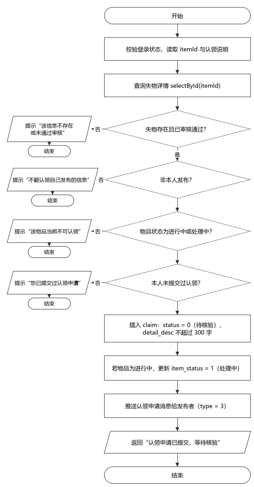

图 4-6 认领申请流程图

**核心伪代码**：

```java
@Transactional
public Long createClaim(ClaimCreateDTO dto) {
    LostItem item = itemMapper.selectById(dto.getItemId());
    if (item == null || item.getAuditStatus() != 1) {
        throw new BusinessException(ResultCode.ITEM_NOT_FOUND);            // 2004
    }
    Long uid = SecurityUtil.getUserId();
    if (item.getUserId().equals(uid)) {
        throw new BusinessException(ResultCode.ITEM_NOT_OWNER);            // 2002
    }
    if (item.getType() != 1 || !Set.of(0, 1).contains(item.getItemStatus())) {
        throw new BusinessException(ResultCode.ITEM_STATUS_ILLEGAL);       // 2003
    }
    Claim claim = new Claim(uid, dto.getItemId(), dto.getDetailDesc(),
                            ClaimStatusEnum.PENDING.getCode(), LocalDateTime.now());
    try {
        claimMapper.insert(claim);                                         // 冲突→3003
    } catch (DuplicateKeyException e) {
        throw new BusinessException(ResultCode.CLAIM_EXISTS);              // uk_item_applicant
    }
    // 0→1：条件更新，已处理中则跳过，不算失败
    itemMapper.update(null, new LambdaUpdateWrapper<LostItem>()
            .eq(LostItem::getId, item.getId())
            .eq(LostItem::getItemStatus, 0)
            .set(LostItem::getItemStatus, 1));
    messageService.push(item.getUserId(), MessageTypeEnum.CLAIM_APPLY,
            "有人申请认领你发布的「" + item.getTitle() + "」");
    return claim.getId();
}
```

**异常分支**：信息不存在 2004；认领自己的信息 3001；非拾物或已完成/已关闭 2003；重复申请 3003；说明字数不符 1001。

#### 4.4.3 U4.3 认领核验通过

**功能说明**：管理员核对申请人提供的特征与信息描述一致后确认归还。该操作具有强一致性要求：通过时物品必须置为"已完成"，且不能与另一管理员的并发操作同时成功。

**输入与输出**：输入 claimId 与可选备注；输出 `Result<Void>`。

**处理流程**（图 4-7 左侧分支）：校验当前用户为管理员（否则 2002）→ 查询 claim（不存在 2004）→ 校验 claim.status=0（否则 3002）→ 查询关联物品（不存在 2004）→ 状态机校验物品 1→2 合法 → 条件更新 `claim SET status=1, admin_id, reply WHERE id=? AND status=0`，影响行数≠1 → 抛 3002（已被他人处理）→ 条件更新 `lost_item SET item_status=2 WHERE id=? AND item_status=1`，影响行数≠1 → 抛 2003 并回滚整个事务 → 将同一物品下其他待核验申请置为拒绝（"物品已归还他人"）→ 给申请人推送通过消息、给发布者推送完成消息 → 提交事务。

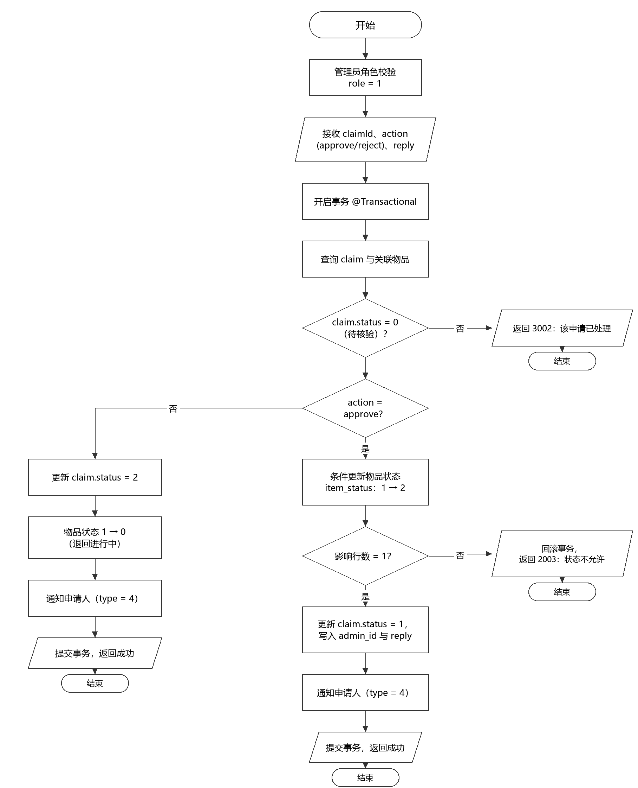

图 4-7 认领核验流程图

**核心伪代码**：

```java
@Transactional(rollbackFor = Exception.class)
public void approve(Long claimId, String reply) {
    SecurityUtil.requireAdmin();                                        // 2002
    Claim claim = claimMapper.selectById(claimId);
    if (claim == null) throw new BusinessException(ResultCode.CLAIM_NOT_FOUND);
    ItemStatusMachine.checkClaim(claim.getStatus());                    // 3002
    int c1 = claimMapper.update(null, new LambdaUpdateWrapper<Claim>()
            .eq(Claim::getId, claimId).eq(Claim::getStatus, 0)
            .set(Claim::getStatus, 1)
            .set(Claim::getAdminId, SecurityUtil.getUserId())
            .set(Claim::getReply, reply));
    if (c1 != 1) throw new BusinessException(ResultCode.CLAIM_STATUS_ILLEGAL);
    int c2 = itemMapper.update(null, new LambdaUpdateWrapper<LostItem>()
            .eq(LostItem::getId, claim.getItemId())
            .eq(LostItem::getItemStatus, 1)                              // 处理中→已完成
            .set(LostItem::getItemStatus, 2));
    if (c2 != 1) throw new BusinessException(ResultCode.ITEM_STATUS_ILLEGAL);   // 触发回滚
    claimMapper.rejectOtherPending(claim.getItemId(), claimId, "物品已归还他人");
    messageService.push(claim.getApplicantId(), MessageTypeEnum.CLAIM_RESULT,
            "你的认领申请已通过，请与发布者联系交接");
    messageService.push(itemMapper.selectById(claim.getItemId()).getUserId(),
            MessageTypeEnum.CLAIM_RESULT, "你的物品已完成归还，信息已关闭");
}
```

**异常分支**：

| 条件 | 返回码 | 说明 |
|---|---|---|
| 非管理员 | 2002 | 权限校验在方法入口 |
| 认领记录不存在 | 2004 | — |
| 该申请已被处理 | 3002 | 并发重复点击 |
| 物品状态已非处理中 | 2003 | 事务整体回滚，claim 状态复原 |
| 数据库异常 | 9999 | 全局处理器统一包装 |

#### 4.4.4 U4.4 认领核验拒绝

**功能说明**：管理员判断申请人特征描述与实物不符时拒绝申请，物品回到"进行中"以便继续被认领（若该物品还有其他待核验申请，则维持"处理中"）。

**输入与输出**：输入 claimId 与拒绝原因（必填，2~100 字）；输出 `Result<Void>`。

**处理流程**（图 4-7 右侧分支）：权限校验 → 查询 claim（2004）→ 校验 status=0（3002）→ 条件更新 claim 为 2 并写入 reply → 统计该物品剩余待核验申请数：为 0 时条件更新物品 1→0，否则保持不变 → 给申请人推送拒绝原因 → 返回成功。

**核心伪代码**（权限校验、查询与状态校验的前四行与 U4.3 相同，只列拒绝特有的分支）：

```java
@Transactional
public void reject(Long claimId, String reason) {
    Claim claim = requirePendingClaim(claimId);            // 2002 / 2004 / 3002，同 U4.3
    int rows = claimMapper.update(null, new LambdaUpdateWrapper<Claim>()
            .eq(Claim::getId, claimId).eq(Claim::getStatus, 0)
            .set(Claim::getStatus, 2)
            .set(Claim::getAdminId, SecurityUtil.getUserId())
            .set(Claim::getReply, reason));
    if (rows != 1) throw new BusinessException(ResultCode.CLAIM_STATUS_ILLEGAL);
    long pending = claimMapper.selectCount(new LambdaQueryWrapper<Claim>()
            .eq(Claim::getItemId, claim.getItemId()).eq(Claim::getStatus, 0));
    if (pending == 0) {                                    // 无其它待核验申请时退回进行中
        itemMapper.update(null, new LambdaUpdateWrapper<LostItem>()
                .eq(LostItem::getId, claim.getItemId())
                .eq(LostItem::getItemStatus, 1)
                .set(LostItem::getItemStatus, 0));
    }
    messageService.push(claim.getApplicantId(), MessageTypeEnum.CLAIM_RESULT,
            "你的认领申请未通过：" + reason);
}
```

**异常分支**：理由为空或超 100 字返回 1001；非管理员 2002；已处理 3002。

#### 4.4.5 U4.5 待核验申请列表

**功能说明**：管理员查询认领申请列表，按状态（默认待核验）与关键词筛选，供后台核验页展示。列表需带出物品标题、物品类型、申请人昵称与学号，便于核对身份。

**输入与输出**：输入 page、size、status（默认 0）、keyword（匹配物品标题或申请人学号）；输出 `PageResult<ClaimVO>`，字段含 id、itemId、itemTitle、itemType、applicantId、applicantName、studentNo、detailDesc、status、reply、createdAt。

**处理流程**：组装条件（status 默认 0）→ 三表关联分页查询（claim ⊕ lost_item ⊕ user）→ 按 `created_at ASC`（先到先审）排序 → 组装 VO 返回。该查询需为 `claim(status, created_at)` 与 `claim(item_id)` 建立索引支撑。

**核心伪代码**：

```java
public PageResult<ClaimVO> page(ClaimQuery q) {
    Page<ClaimVO> page = new Page<>(q.safePage(), q.safeSize());
    return PageResult.of(claimMapper.selectPageWithItem(page,
            q.getStatus() == null ? 0 : q.getStatus(), q.getKeyword()));
}
```

```xml
SELECT c.id, c.item_id, i.title AS item_title, i.type AS item_type,
       u.id AS applicant_id, u.nickname, u.student_no,
       c.detail_desc, c.status, c.reply, c.created_at
FROM claim c
JOIN lost_item i ON i.id = c.item_id
JOIN user u      ON u.id = c.applicant_id
WHERE c.status = #{status}
  <if test="kw != null"> AND (i.title LIKE CONCAT('%',#{kw},'%') OR u.student_no LIKE CONCAT('%',#{kw},'%')) </if>
ORDER BY c.created_at ASC
```

**异常分支**：非管理员 2002；status 非 0/1/2 返回 1001；分页参数越界按规则纠正。

### 4.5 M5 留言与消息模块

留言是公开的（详情页可见），消息是私有的（站内通知）。两者共用"推送"能力：凡是需要通知用户的事件（审核结果、认领申请、认领结果、留言提醒、系统通知），统一由 `MessageService.push()` 落库，前端通过未读数轮询感知。

#### 4.5.1 U5.1 发表留言

**功能说明**：登录用户在信息详情页发表公开留言（咨询物品细节、提供线索）。单条 1~400 字，不允许多层回复（按需求简化为平铺列表）。

**输入与输出**：输入 itemId、content；输出新留言的 VO（含留言人昵称与时间，供前端即时插入列表）。

**处理流程**：校验信息存在且已审核通过（否则 2004）→ 校验内容长度（1001）→ 插入 comment（user_id、item_id、content、created_at）→ 给信息发布者推送"留言提醒"消息（发布者留言给自己时不推送）→ 返回留言 VO。

**核心伪代码**：

```java
@Transactional
public CommentVO addComment(Long itemId, String content) {
    LostItem item = itemMapper.selectById(itemId);
    if (item == null || item.getAuditStatus() != 1) {
        throw new BusinessException(ResultCode.ITEM_NOT_FOUND);
    }
    Comment c = new Comment(itemId, SecurityUtil.getUserId(), content, LocalDateTime.now());
    commentMapper.insert(c);
    if (!item.getUserId().equals(c.getUserId())) {
        messageService.push(item.getUserId(), MessageTypeEnum.COMMENT,
                "你的信息收到一条新留言");
    }
    return CommentVO.of(c, userMapper.selectById(c.getUserId()));
}
```

**异常分支**：信息不存在或未过审 2004；内容为空或超 400 字 1001；未登录 401（由拦截器处理）。

#### 4.5.2 U5.2 删除留言

**功能说明**：留言作者本人或管理员可删除留言，删除为物理删除（留言价值低、无审计要求）。删除后不可恢复。

**输入与输出**：输入 commentId；输出 `Result<Void>`。

**处理流程**：查询留言（不存在返回 2004）→ 校验为作者或管理员（否则 2002）→ `DELETE FROM comment WHERE id=?` → 返回成功。删除成功后前端从列表移除并刷新总数。

**核心伪代码**：

```java
public void deleteComment(Long id) {
    Comment c = commentMapper.selectById(id);
    if (c == null) throw new BusinessException(ResultCode.ITEM_NOT_FOUND);
    if (!c.getUserId().equals(SecurityUtil.getUserId()) && !SecurityUtil.isAdmin()) {
        throw new BusinessException(ResultCode.ITEM_NOT_OWNER);        // 2002
    }
    commentMapper.deleteById(id);
}
```

**异常分支**：留言不存在 2004；非作者且非管理员 2002；删除他人留言被拒绝且数据不变。

#### 4.5.3 U5.3 消息推送（内部服务）

**功能说明**：系统内部统一的消息落库入口，被审核、认领、留言等单元调用。不对外暴露 HTTP 接口。

**输入与输出**：输入接收人 id、消息类型、内容、关联信息 id（可空）；输出 `void`（失败只记日志，不影响主业务）。

**处理流程**：校验接收人存在且非系统账号 → 组装 Message（from_user_id 默认 0 表示系统，is_read=0）→ 插入 → 若插入异常则捕获并记录日志，不回滚主事务（消息属于"尽力而为"的通知，不能因通知失败导致业务失败）。

**核心伪代码**：

```java
@Transactional(propagation = Propagation.REQUIRES_NEW)
public void push(Long toUserId, MessageTypeEnum type, String content, Long itemId) {
    try {
        Message m = new Message(toUserId, 0L, type.getCode(), content, itemId, 0, LocalDateTime.now());
        messageMapper.insert(m);
    } catch (Exception e) {
        log.error("push message failed, to={}, type={}", toUserId, type, e);   // 吞掉异常
    }
}
```

**异常分支**：接收人不存在则不插入；数据库异常仅记日志。设计取舍：用 `REQUIRES_NEW` 保证消息写入不受外层事务回滚影响（例如核验失败回滚时，已发出的通知仍保留，便于用户感知操作曾发生）；若追求严格一致可改为同一事务，此处选择"通知优先送达"。

#### 4.5.4 U5.4 消息列表、已读与未读数

**功能说明**：用户在消息中心查看自己的消息（分页、可按已读状态筛选），支持单条标记已读与全部已读；导航栏展示未读总数。

**输入与输出**：

| 接口 | 输入 | 输出 |
|---|---|---|
| GET /api/messages | page、size、isRead | PageResult\<MessageVO\> |
| PUT /api/messages/{id}/read | 消息 id | Result\<Void\> |
| GET /api/messages/unread-count | — | {count} |

**处理流程**：列表按 `to_user_id=当前用户` 过滤并倒序；已读操作先校验消息归属（非本人 2002），再更新 is_read=1；未读数用 `SELECT COUNT(*)` 直接统计并返回。前端在路由切换与定时器（60 秒）中刷新未读数。

**核心伪代码**：

```java
public void markRead(Long id) {
    Message m = messageMapper.selectById(id);
    if (m == null || !m.getToUserId().equals(SecurityUtil.getUserId())) {
        throw new BusinessException(ResultCode.NO_PERMISSION);          // 2002
    }
    if (m.getIsRead() == 0) {
        messageMapper.update(null, new LambdaUpdateWrapper<Message>()
                .eq(Message::getId, id).set(Message::getIsRead, 1));
    }
}

public long unreadCount() {
    return messageMapper.selectCount(new LambdaQueryWrapper<Message>()
            .eq(Message::getToUserId, SecurityUtil.getUserId())
            .eq(Message::getIsRead, 0));
}
```

**异常分支**：越权标记他人消息 2002；消息不存在 2004；未登录 401。

### 4.6 M6 管理后台模块

后台模块只对 role=1 开放，所有接口在进入 Controller 前由 `AdminInterceptor` 校验角色，业务方法内再校验一次（防止绕过），形成双重保险。

#### 4.6.1 U6.1 信息审核

**功能说明**：管理员对待审核（audit_status=0）的失物信息逐条审核，通过则对外可见，驳回则记录原因并通过站内消息告知发布者，发布者修改后可重新提交审核。

**输入与输出**：

| 项 | 字段 | 说明 |
|---|---|---|
| 输入（GET） | page、size、auditStatus（默认 0）、keyword | 列表含标题、分类、发布者、提交时间、图片数 |
| 输出（GET） | PageResult\<ItemListVO\> | 待审核列表 |
| 输入（PUT） | auditStatus（1 通过 / 2 驳回）、rejectReason（驳回时必填 2~100 字） | 目标 id 在路径 |
| 输出（PUT） | Result\<Void\> | — |

**处理流程**（图 4-8）：权限校验 → 查询信息（2004）→ 校验当前 audit_status=0（否则 2003，"该信息已审核"）→ 若驳回则校验原因非空（1001）→ 条件更新 `SET audit_status=?, reject_reason=? WHERE id=? AND audit_status=0`，影响行数≠1 抛 2003 → 推送审核结果消息给发布者 → 返回成功。通过时不写 reject_reason（置 null）。

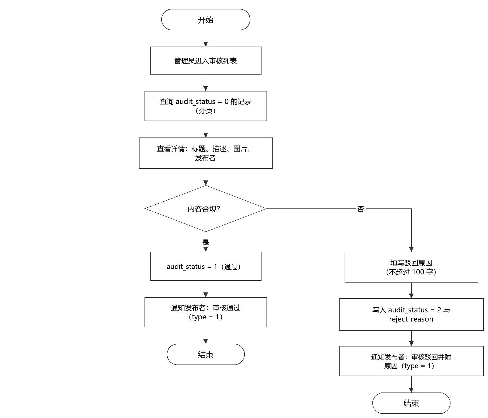

图 4-8 信息审核流程图

**核心伪代码**：

```java
@Transactional
public void audit(Long id, AuditDTO dto) {
    LostItem item = itemMapper.selectById(id);
    if (item == null) throw new BusinessException(ResultCode.ITEM_NOT_FOUND);
    if (item.getAuditStatus() != 0) {
        throw new BusinessException(ResultCode.ITEM_STATUS_ILLEGAL);         // 已审核
    }
    if (dto.getAuditStatus() == 2 && !StringUtils.hasText(dto.getRejectReason())) {
        throw new BusinessException(ResultCode.PARAM_ERROR);                 // 驳回必填原因
    }
    int rows = itemMapper.update(null, new LambdaUpdateWrapper<LostItem>()
            .eq(LostItem::getId, id).eq(LostItem::getAuditStatus, 0)
            .set(LostItem::getAuditStatus, dto.getAuditStatus())
            .set(LostItem::getRejectReason,
                 dto.getAuditStatus() == 2 ? dto.getRejectReason() : null));
    if (rows != 1) throw new BusinessException(ResultCode.ITEM_STATUS_ILLEGAL);
    String text = dto.getAuditStatus() == 1
            ? "你发布的「" + item.getTitle() + "」已通过审核"
            : "你发布的「" + item.getTitle() + "」未通过审核：" + dto.getRejectReason();
    messageService.push(item.getUserId(), MessageTypeEnum.AUDIT, text, id);
}
```

**异常分支**：非管理员 2002；信息不存在 2004；已审核 2003；驳回原因为空 1001；auditStatus 非 1/2 返回 1001。

#### 4.6.2 U6.2 分类管理

**功能说明**：管理员维护失物分类（新增、改名、排序、删除）。分类名唯一；已有关联信息的分类不允许删除，避免出现"信息指向不存在分类"。

**输入与输出**：

| 操作 | 输入 | 说明 |
|---|---|---|
| 列表 | — | 按 sort 升序，返回 id、name、sort、itemCount |
| 新增 | name（2~10 字）、sort | 重名返回 5001 |
| 修改 | id、name、sort | 同上，改名需重新校验唯一 |
| 删除 | id | 存在关联信息返回 5002 |

**处理流程**：新增前按 name 查重（5001），唯一索引兜底；修改时排除自身再查重；删除前 `SELECT COUNT(*) FROM lost_item WHERE category_id=?`，大于 0 则拒绝（5002）。列表的 itemCount 用一次分组统计查询填充，避免逐行计数。

**核心伪代码**：

```java
@Transactional
public void delete(Long id) {
    if (categoryMapper.selectById(id) == null) {
        throw new BusinessException(ResultCode.CATEGORY_NOT_FOUND);           // 5003
    }
    long used = itemMapper.selectCount(new LambdaQueryWrapper<LostItem>()
            .eq(LostItem::getCategoryId, id));
    if (used > 0) throw new BusinessException(ResultCode.CATEGORY_IN_USE);    // 5002
    categoryMapper.deleteById(id);
}

@Transactional
public void create(CategoryDTO dto) {
    if (categoryMapper.selectCount(new LambdaQueryWrapper<Category>()
            .eq(Category::getName, dto.getName())) > 0) {
        throw new BusinessException(ResultCode.CATEGORY_EXISTS);              // 5001
    }
    categoryMapper.insert(new Category(dto.getName(), dto.getSort()));
}
```

**异常分支**：分类不存在 5003；重名 5001；存在关联信息 5002；名称超 10 字 1001。

#### 4.6.3 U6.3 用户列表查询

**功能说明**：管理员按角色、状态、关键词分页查看全部用户，为 U1.7 的状态管理提供列表数据；接口与 U1.7 共用同一 Service 方法，仅前端入口不同。

**输入与输出**：输入 page、size、role、status、keyword（学号或昵称）；输出 PageResult\<UserVO\>（不含密码，含注册时间、发布数、认领数）。

**处理流程**：组装条件分页查询 user 表 → 批量统计各用户的发布数与认领数（`GROUP BY user_id` 两条聚合查询，避免 N+1）→ 组装 VO。统计列在列表中只做展示，不参与排序。

**核心伪代码**：

```java
public PageResult<UserVO> page(UserQuery q) {
    Page<User> page = new Page<>(q.safePage(), q.safeSize());
    userMapper.selectPage(page, new LambdaQueryWrapper<User>()
            .eq(q.getRole() != null, User::getRole, q.getRole())
            .eq(q.getStatus() != null, User::getStatus, q.getStatus())
            .and(StringUtils.hasText(q.getKeyword()), w -> w
                    .like(User::getStudentNo, q.getKeyword())
                    .or().like(User::getNickname, q.getKeyword()))
            .orderByDesc(User::getCreatedAt));
    Map<Long, Long> itemCount = itemMapper.countByUsers(page.getRecordIds());
    Map<Long, Long> claimCount = claimMapper.countByUsers(page.getRecordIds());
    return PageResult.of(page, u -> UserVO.of(u, itemCount, claimCount));
}
```

**异常分支**：非管理员 2002；role/status 取值非法 1001；无匹配返回空页。

#### 4.6.4 U6.4 数据统计

**功能说明**：为后台首页提供四项核心指标、近 7 日发布趋势、分类分布与完成率明细，是 ECharts 图表的数据源。

**指标口径**：

| 指标 | 计算口径 |
|---|---|
| 失物信息总数 | 全部 lost_item 记录数（含各审核状态） |
| 待审核数 | `audit_status = 0` 的记录数 |
| 已完成认领数 | `item_status = 2` 的记录数 |
| 归还率 | 已审核通过的拾物中 `item_status=2` 的数量 ÷ 已审核通过的拾物总数，保留 1 位小数；分母为 0 时返回 0.0 |
| 近 7 日趋势 | 按 `created_at` 的日期分组统计每日发布量，缺失日期补 0 |
| 分类分布 | 按 category 分组统计信息数及占比 |

**处理流程**（图 4-9）：并行执行四项 count 查询 → 查询近 7 日分组数据并按日期序列补齐（生成 7 个连续日期，用 Map 取值，缺省 0）→ 查询分类分组数据 → 计算百分比并保留 1 位小数 → 组装 StatsVO 返回。所有查询走聚合与索引，单次请求 SQL 数量固定为 5 条。

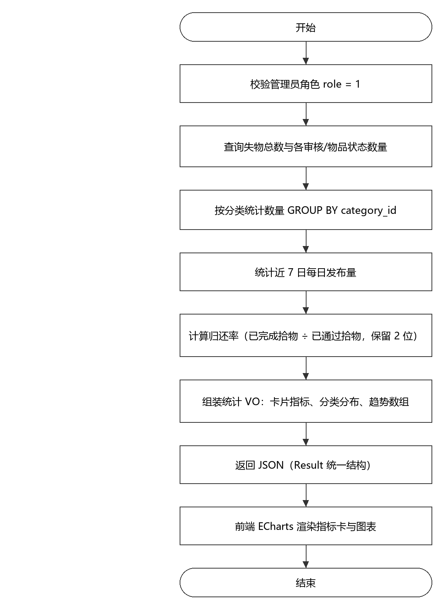

图 4-9 数据统计流程图

**核心伪代码**：

```java
public StatsVO stats() {
    long total     = itemMapper.selectCount(null);
    long pending   = itemMapper.selectCount(new LambdaQueryWrapper<LostItem>()
                          .eq(LostItem::getAuditStatus, 0));
    long done      = itemMapper.selectCount(new LambdaQueryWrapper<LostItem>()
                          .eq(LostItem::getItemStatus, 2));
    long foundTotal = itemMapper.selectCount(new LambdaQueryWrapper<LostItem>()
                          .eq(LostItem::getType, 1).eq(LostItem::getAuditStatus, 1));
    long foundDone  = itemMapper.selectCount(new LambdaQueryWrapper<LostItem>()
                          .eq(LostItem::getType, 1).eq(LostItem::getAuditStatus, 1)
                          .eq(LostItem::getItemStatus, 2));
    double rate = foundTotal == 0 ? 0.0
            : BigDecimal.valueOf(foundDone * 100.0 / foundTotal)
                        .setScale(1, RoundingMode.HALF_UP).doubleValue();

    Map<LocalDate, Long> trendMap = itemMapper.countByDay(LocalDate.now().minusDays(6));
    List<Long> trend = new ArrayList<>();
    for (int i = 6; i >= 0; i--) trend.add(trendMap.getOrDefault(LocalDate.now().minusDays(i), 0L));

    return StatsVO.of(total, pending, done, rate, trend, itemMapper.countByCategory());
}
```

**异常分支**：无数据时各指标返回 0、趋势返回 7 个 0、分类列表为空数组，接口不报错；非管理员 2002。

### 4.7 单元测试要点汇总

各单元的"处理流程"与"异常分支"已经给出判定项，这里按单元集中列出必须覆盖的用例与断言，作为"编码与单元测试"环节的交接依据；表中出现的返回码与第 9 章错误码表一一对应，断言中提到的字段名与第 5 章表结构一致。

表 4-7 程序单元测试要点

| 单元 | 关键用例与断言 |
|---|---|
| U1.1 学生注册 | 注册成功后库中存在 role=0、status=0 的记录且密码非明文；同学号再次注册返回 1002；学号 6 位与 12 位通过、5 位与 13 位被拒；非法手机号被拒；并发注册同学号仅一条入库 |
| U1.2 登录 | 正确凭据返回可解析出 uid/role 的 token；错误密码与不存在学号都返回 1003（两者不可区分）；禁用账号返回 1004；返回体中无 password 字段 |
| U1.3 退出登录 | 携带有效 token 返回 200；无 token 返回 401；前端登录态被清空 |
| U1.4 个人资料 | GET 响应不含 password；只传 nickname 时 phone 保持不变；传空对象不改数据并返回 200；始终以 token 中的 uid 为准，无法修改他人资料 |
| U1.5 修改密码 | 修改后新密码可登录、旧密码失效；原密码错误返回 1005 且摘要不变；新旧密码相同返回 1001；并发两次修改只有一次成功 |
| U1.6 我的发布/认领/留言 | 只返回本人数据（用两个用户交叉验证）；按时间倒序；size=100 时实际返回不超过 50；空结果返回空数组而非 null |
| U1.7 账号状态管理 | 学生账号可禁用、可再启用；越权操作返回 2002；被禁用用户持旧 token 请求返回 403/1004；按学号前缀筛选能命中 |
| U2.1 发布失物信息 | 发布后 audit_status=0、item_status=0 且不出现在公开列表；2 张图对应 2 条 item_image 且 sort 为 0/1；4 张图返回 4004；分类不存在返回 5003；图片插入失败时主表不残留 |
| U2.2 图片上传 | 正常 jpg 返回 /uploads/ 前缀 URL 且文件存在；空文件 4001；2MB+1 字节 4002；exe 改名为 .png 被魔数校验拒绝（4003） |
| U2.3 编辑失物信息 | 修改后 audit_status 回到 0、reject_reason 被清空；他人修改 2002；已完成信息修改 2003；images 传空数组时图片被清空、传 null 时不变 |
| U2.4 关闭信息 | 进行中信息可关闭、状态变 3；已完成信息关闭返回 2003；他人关闭 2002；待核验认领被置为拒绝并收到消息；重复关闭第二次返回 2003 而非 500 |
| U3.1 列表查询与分页 | 待审核与已关闭信息不出现；total 与实际条数一致；封面取 sort 最小的图；空库返回空数组；size=100 被截断为 50 |
| U3.2 关键词搜索 | 标题命中的记录排在仅描述命中的记录之前；关键词含 `%` 时按字面匹配；中文与英文混排均可命中；搜索不返回待审核信息；空关键词等价于普通列表 |
| U3.3 信息详情 | 未登录访问已通过信息时 contact 为掩码，发布者本人可见完整 contact；待审核信息对他人返回 2004；图片按 sort 升序；myClaimStatus 与 claim 表一致；留言超过 10 条时截断或分页 |
| U4.1 状态机 | 穷举物品 4×4 状态组合，仅表中允许的组合通过；终态不可再变；认领仅待核验状态可处理；异常信息含 from 与 to |
| U4.2 发起认领申请 | 首次申请成功且物品状态变 1；同一用户重复申请 3003；认领自己发布的信息 3001；对寻物（type=0）申请 2003；两人并发申请时两条 claim 均入库、物品状态为 1；发布者收到消息 |
| U4.3 核验通过 | 通过后 claim.status=1、item_status=2；重复点击第二次返回 3002 且状态不变；同一物品其它待核验申请被置为拒绝；物品条件更新失败时 claim 状态回滚为 0；申请人与发布者各收一条消息 |
| U4.4 核验拒绝 | 拒绝后 claim.status=2 且物品回到 0；该物品仍有其它待核验申请时维持 1；拒绝原因为空返回 1001 且状态不变；申请人收到含原因的拒绝消息 |
| U4.5 待核验申请列表 | 默认只返回待核验申请；按学号搜索命中；昵称与学号一并返回；按 created_at 升序；空结果返回空数组 |
| U5.1 发表留言 | 发表后详情页留言列表可见；超 400 字被拒；给他人留言时发布者收到消息、给自己留言不推送；待审核信息不可留言（2004） |
| U5.2 删除留言 | 作者删除成功；他人删除 2002；管理员可删除任意留言；重复删除第二次返回 2004 |
| U5.3 消息推送 | 推送后库中出现 is_read=0 的记录；主事务回滚时消息仍存在（REQUIRES_NEW 生效）；异常被吞掉且有日志；type 与 itemId 正确写入 |
| U5.4 消息列表与未读数 | 列表只含本人消息；标记已读后未读数减 1；重复标记不报错；标记他人消息 2002；未读数与列表中未读条数一致 |
| U6.1 信息审核 | 通过后 audit_status=1 且出现在公开列表；驳回后 audit_status=2、reject_reason 有值且不出现；重复审核 2003；驳回未填原因 1001；发布者收到对应内容的消息 |
| U6.2 分类管理 | 新增后按 sort 排序；重名新增 5001（改回自身名称允许）；删除被引用的分类 5002；删除空分类成功 |
| U6.3 用户列表 | 只返回脱敏字段（无 password）；按学号精确命中；发布数与认领数与事实一致；分页 total 正确；status 筛选生效 |
| U6.4 数据统计 | 空库时指标全 0、归还率 0.0、趋势长度为 7；3 条拾物其中 2 条已完成时归还率为 66.7；趋势按日期升序、缺失日期补 0；分类占比合计为 100%；1000 条数据内响应时间小于 200ms |

除上表用例，每个单元还应覆盖"参数缺失、类型错误、越权访问"这三类公共分支：前两类由 Jakarta Validation 与全局异常处理器统一拦下并返回 1001，最后一类由 `SecurityUtil` 与拦截器返回 2002 或 401，因此不再逐单元重复。

## 5 数据库详细设计

### 5.1 概念模型与表关系

数据库 `lost_found` 使用 InnoDB 引擎、utf8mb4 字符集，共 7 张表。概念层的实体联系如图 5-1：`用户` 是中心实体，`失物信息` 同时与用户、分类建立联系；`认领申请`、`留言`、`站内消息` 既依附于 `失物信息`，又可追溯到提交人；`信息图片` 为 `失物信息` 的从属实体。图中矩形为实体、椭圆为属性、菱形为联系，连线上标注 1 与 N 表示联系基数；受图纸密度限制，椭圆只标注主键与关键业务属性，完整字段见 `lost_found.sql` 与 5.2 节索引表。

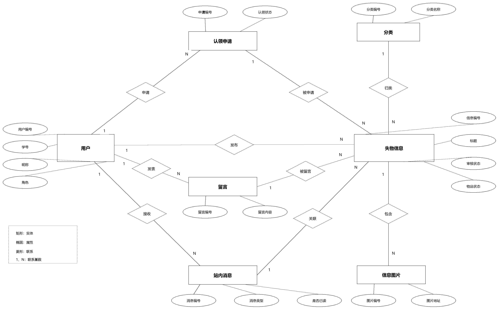

图 5-1 实体联系图

概念模型到物理表的对应关系是：`item_image`、`claim`、`comment` 通过外键依附于 `lost_item`，`message` 只依赖 `user`（`from_user_id = 0` 表示系统消息），9 条外键列全部建立索引以支撑关联查询。

| 表名 | 说明 | 主要关系 | 估算行数 |
|---|---|---|---|
| user | 用户（学生与管理员） | 1:N lost_item、claim、comment、message | 5 000 |
| category | 失物分类 | 1:N lost_item | 6 |
| lost_item | 失物信息主表 | N:1 user、category | 20 000 |
| item_image | 信息图片 | N:1 lost_item | 40 000 |
| claim | 认领申请 | N:1 lost_item、user | 8 000 |
| comment | 公开留言 | N:1 lost_item、user | 30 000 |
| message | 站内消息 | N:1 user | 60 000 |

### 5.2 索引设计

索引设计遵循三条原则：等值条件与排序字段组合建联合索引；区分度低的布尔字段不做单列索引；所有外键列建索引以支撑关联查询与级联检查。7 张表均以 `id` 为自增主键（`PRIMARY KEY`），下表只列辅助索引，与 `lost_found.sql` 中的定义逐条对应。

| 表 | 索引 | 类型 | 支撑的查询 |
|---|---|---|---|
| user | uk_user_student_no(student_no) | 唯一 | 注册查重、登录查询 |
| user | idx_user_role_status(role, status) | 普通 | 后台按角色与状态筛选 |
| category | uk_category_name(name) | 唯一 | 分类重名校验 |
| lost_item | idx_item_audit_status(audit_status, created_at) | 普通 | 审核列表按提交时间、公开列表 |
| lost_item | idx_item_type_status(type, item_status) | 普通 | 按寻物/拾物与物品状态筛选 |
| lost_item | idx_item_category(category_id) | 普通 | 分类筛选、删除前引用校验 |
| lost_item | idx_item_user(user_id) | 普通 | 我的发布 |
| item_image | idx_image_item(item_id, sort) | 普通 | 取图并按展示顺序排序 |
| claim | uk_claim_item_applicant(item_id, applicant_id) | 唯一 | 同一用户对同一信息仅可申请一次 |
| claim | idx_claim_status_created(status, created_at) | 普通 | 待核验列表（先到先审） |
| claim | idx_claim_applicant(applicant_id) | 普通 | 我的认领 |
| claim | idx_claim_admin(admin_id) | 普通 | 按核验管理员回溯，覆盖外键列 |
| comment | idx_comment_item(item_id, created_at) | 普通 | 详情页留言列表 |
| comment | idx_comment_user(user_id) | 普通 | 我的留言 |
| message | idx_msg_to_read(to_user_id, is_read, created_at) | 普通 | 消息列表与未读数 |

关键字搜索采用 `LIKE '%kw%'`，无法利用 B+ 树前缀索引；在 2 万行规模下配合 `audit_status` 过滤可接受（实测约束见 NFR-01）。若后续数据量增长，再引入 MySQL 全文索引或独立搜索服务，本期不做。

### 5.3 完整性约束与删除策略

1. **主键**：全部表使用 `BIGINT AUTO_INCREMENT`，避免业务主键变更带来的级联修改。
2. **外键**：`lost_item.user_id → user.id`、`lost_item.category_id → category.id`、`item_image.item_id → lost_item.id`（ON DELETE CASCADE）、`claim.item_id → lost_item.id`、`claim.applicant_id → user.id`、`claim.admin_id → user.id`（ON DELETE SET NULL）、`comment.item_id → lost_item.id`（ON DELETE CASCADE）、`comment.user_id → user.id`、`message.to_user_id → user.id`。
3. **不使用外键的字段**：`message.from_user_id`（0 表示系统，无法满足外键）与 `message.item_id`（消息在信息删除后仍需保留线索，故只存 id 不建约束）。
4. **删除策略**：业务上不物理删除失物信息，一律"关闭"；仅图片与留言随信息级联删除。用户不做删除，只置 status=1 禁用。
5. **枚举落库**：状态字段使用 `TINYINT` 存编码，含义由 Java 枚举维护，数据库注释同步说明，禁止在 SQL 中硬编码魔法数字以外的场景（统计 SQL 除外）。

### 5.4 事务边界

| 业务操作 | 事务范围 | 隔离级别 | 关键点 |
|---|---|---|---|
| 发布信息 | lost_item 插入 + item_image 批量插入 | 默认（REPEATABLE READ） | 图片与主表同生共死 |
| 编辑信息 | 主表更新 + 图片删插 | 默认 | 先删后插，失败整体回滚 |
| 发起认领 | claim 插入 + lost_item 状态 0→1 + 消息推送 | 默认 | 消息用 REQUIRES_NEW，不受回滚影响 |
| 核验通过 | claim 更新 + lost_item 1→2 + 其他申请置拒绝 + 消息 | 默认 | 两次条件更新均须影响 1 行，否则抛异常回滚 |
| 核验拒绝 | claim 更新 + 可能的 lost_item 1→0 + 消息 | 默认 | 计数剩余待核验申请 |
| 关闭信息 | lost_item→3 + 待核验申请置拒绝 + 消息 | 默认 | 仅 0/1 状态可关闭 |
| 审核 | lost_item.audit_status 条件更新 + 消息 | 默认 | 条件中带 audit_status=0 防重复审核 |
| 注册/改密 | 单表写 | 默认 | 依赖唯一索引与乐观条件 |

事务内禁止：文件 IO（图片上传已完成，事务内只写 URL）、外部 HTTP 调用、长耗时统计查询。

### 5.5 关键 SQL

```sql
-- 1. 公开列表（分页 + 类型/分类/关键词组合，走 idx_item_audit_status）
SELECT i.id, i.type, i.title, i.happen_place, i.happen_time, i.item_status, i.created_at
FROM lost_item i
WHERE i.audit_status = 1 AND i.item_status IN (0, 1)
  AND (#{type} IS NULL OR i.type = #{type})
  AND (#{categoryId} IS NULL OR i.category_id = #{categoryId})
ORDER BY i.created_at DESC
LIMIT #{offset}, #{size};

-- 2. 一次取回本页所有封面图（避免 N+1）
SELECT item_id, url FROM item_image
WHERE item_id IN (...) AND sort = 0;

-- 3. 核验通过：条件更新，影响行数必须为 1
UPDATE claim SET status = 1, admin_id = #{adminId}, reply = #{reply}
WHERE id = #{id} AND status = 0;

UPDATE lost_item SET item_status = 2
WHERE id = #{itemId} AND item_status = 1;

-- 4. 核验拒绝后统计剩余待核验申请
SELECT COUNT(*) FROM claim WHERE item_id = #{itemId} AND status = 0;

-- 5. 近 7 日发布趋势（缺失日期在应用层补 0）
SELECT DATE(created_at) AS d, COUNT(*) AS c
FROM lost_item
WHERE created_at >= #{startDate}
GROUP BY DATE(created_at);

-- 6. 分类分布与完成率
SELECT c.id, c.name, COUNT(i.id) AS total,
       SUM(CASE WHEN i.item_status = 2 THEN 1 ELSE 0 END) AS done
FROM category c LEFT JOIN lost_item i ON i.category_id = c.id
GROUP BY c.id, c.name ORDER BY c.sort;

-- 7. 删除分类前的占用检查
SELECT COUNT(*) FROM lost_item WHERE category_id = #{categoryId};

-- 8. 消息未读数（走 idx_msg_to_read）
SELECT COUNT(*) FROM message WHERE to_user_id = #{uid} AND is_read = 0;
```

### 5.6 初始化数据与管理员账号

分类种子数据在 `lost_found.sql` 中以 `INSERT` 固定 6 条（证件、电子产品、钥匙、书籍、衣物、其他，sort 1~6），保证系统首次启动即有可用分类。

管理员账号**不在 SQL 中写死 BCrypt 密文**：BCrypt 每次加密同一密码得到的密文不同，硬编码既无法校验真伪，也不利于后期更换成本参数。改由应用启动时的 `DataInitializer` 幂等创建：

```java
@Component
@RequiredArgsConstructor
public class DataInitializer implements CommandLineRunner {
    private final UserMapper userMapper;
    private final BCryptPasswordEncoder encoder;   // cost = 10

    @Override
    public void run(String... args) {
        Long cnt = userMapper.selectCount(new LambdaQueryWrapper<User>()
                .eq(User::getRole, 1));
        if (cnt > 0) return;                        // 已存在管理员则跳过
        User admin = new User();
        admin.setStudentNo("admin");
        admin.setPassword(encoder.encode("Admin@123"));
        admin.setNickname("系统管理员");
        admin.setPhone("13800000000");
        admin.setRole(1);
        admin.setStatus(0);
        admin.setCreatedAt(LocalDateTime.now());
        userMapper.insert(admin);
    }
}
```

初始口令 `Admin@123` 仅用于首次登录，部署文档要求管理员登录后立即在个人中心修改。若口令遗失，可执行以下片段重置：

```java
// 应急重置：将 student_no = 'admin' 的密码改为 Admin@123
userMapper.update(null, new LambdaUpdateWrapper<User>()
        .eq(User::getStudentNo, "admin")
        .set(User::getPassword, encoder.encode("Admin@123")));
```

### 5.7 备份与容量

单机部署下采用"每日逻辑备份 + 二进制日志"的简单方案：`mysqldump --single-transaction` 每日凌晨导出，保留 7 天；上传目录与数据库备份同批次打包。按估算行数，数据文件首年不超过 50MB，无需分库分表。

## 6 接口详细设计

### 6.1 接口实现结构

后端接口实现遵循固定链路：`JwtInterceptor`（白名单放行、解析 token、写入 ThreadLocal）→ `AdminInterceptor`（role=1 才放行 /api/admin/** 与写操作）→ Controller（DTO 绑定 + `@Valid` 校验）→ Service（业务规则 + 事务）→ Mapper → `Result` 封装 → `GlobalExceptionHandler` 兜底。字段级规格、JSON 示例与全部错误码见《API接口详细规格.md》，本节只说明设计与实现层面的约定。

统一响应结构：

```json
{ "code": 200, "message": "success", "data": { } }
```

分页响应结构：

```json
{ "code": 200, "message": "success",
  "data": { "total": 128, "page": 1, "size": 12, "pages": 11, "records": [] } }
```

### 6.2 接口清单

| 序号 | 方法与路径 | 权限 | 单元 |
|---|---|---|---|
| 1 | POST /api/auth/register | 公开 | U1.1 |
| 2 | POST /api/auth/login | 公开 | U1.2 |
| 3 | POST /api/auth/logout | 登录 | U1.3 |
| 4 | GET /api/user/profile | 登录 | U1.4 |
| 5 | PUT /api/user/profile | 登录 | U1.4 |
| 6 | PUT /api/user/password | 登录 | U1.5 |
| 7 | GET /api/user/items | 登录 | U1.6 |
| 8 | GET /api/user/claims | 登录 | U1.6 |
| 9 | GET /api/user/comments | 登录 | U1.6 |
| 10 | POST /api/items | 登录 | U2.1 |
| 11 | PUT /api/items/{id} | 发布者/管理员 | U2.3 |
| 12 | PUT /api/items/{id}/close | 发布者/管理员 | U2.4 |
| 13 | POST /api/upload/image | 登录 | U2.2 |
| 14 | GET /api/items | 公开 | U3.1、U3.2 |
| 15 | GET /api/items/{id} | 公开 | U3.3 |
| 16 | POST /api/claims | 登录 | U4.2 |
| 17 | GET /api/claims | 管理员 | U4.5 |
| 18 | PUT /api/claims/{id}/approve | 管理员 | U4.3 |
| 19 | PUT /api/claims/{id}/reject | 管理员 | U4.4 |
| 20 | POST /api/comments | 登录 | U5.1 |
| 21 | DELETE /api/comments/{id} | 发布者/管理员 | U5.2 |
| 22 | GET /api/messages | 登录 | U5.4 |
| 23 | PUT /api/messages/{id}/read | 登录 | U5.4 |
| 24 | GET /api/messages/unread-count | 登录 | U5.4 |
| 25 | GET /api/admin/items/audit | 管理员 | U6.1 |
| 26 | PUT /api/admin/items/{id}/audit | 管理员 | U6.1 |
| 27 | GET /api/admin/categories | 公开 | U6.2 |
| 28 | POST /api/admin/categories | 管理员 | U6.2 |
| 29 | PUT /api/admin/categories/{id} | 管理员 | U6.2 |
| 30 | DELETE /api/admin/categories/{id} | 管理员 | U6.2 |
| 31 | GET /api/admin/users | 管理员 | U6.3、U1.7 |
| 32 | PUT /api/admin/users/{id}/status | 管理员 | U1.7 |
| 33 | GET /api/admin/stats | 管理员 | U6.4 |

### 6.3 登录鉴权时序

登录与后续鉴权的交互如图 6-1：前端提交学号密码，服务端查询用户并做 BCrypt 比对，签发 JWT 返回；此后每个请求由拦截器解析令牌、加载角色，业务方法从 ThreadLocal 取当前用户。

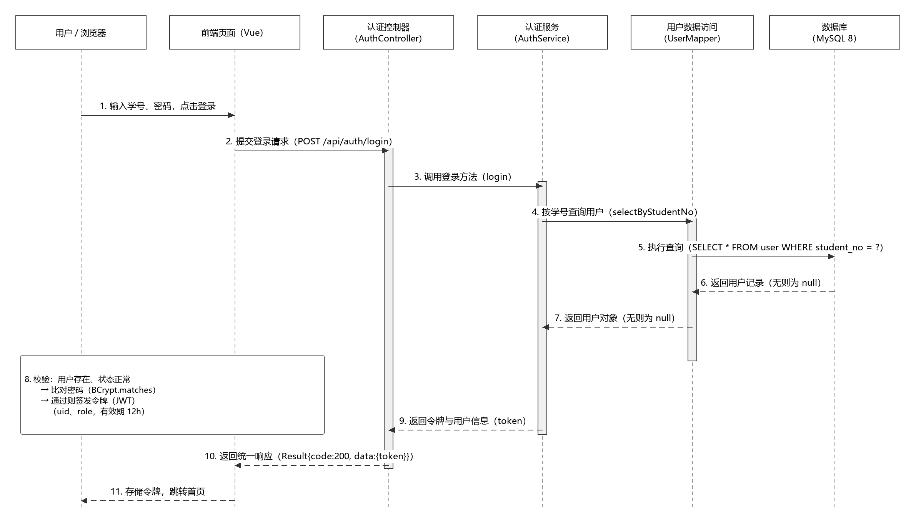

图 6-1 登录鉴权时序图

实现要点：`JwtUtil.generate()` 使用 HS256 与固定密钥（配置在 `application.yml` 的 `jwt.secret`，长度 ≥32 字节），claims 仅含 `uid` 与 `role`，不放入昵称等可变信息，避免令牌与库中数据不一致；`JwtInterceptor` 校验签名与过期时间后，还查库确认用户 status=0（保证禁用即时生效），再写入 ThreadLocal，`afterCompletion` 中 `remove()` 防止线程复用串号。

### 6.4 认领核验时序

核验通过是本系统最需要保证一致性的接口，交互如图 6-2：管理员发起 → Controller 校验角色 → Service 依次执行状态机校验、claim 条件更新、item 条件更新、无关申请置拒绝、消息推送，任一步失败整体回滚。

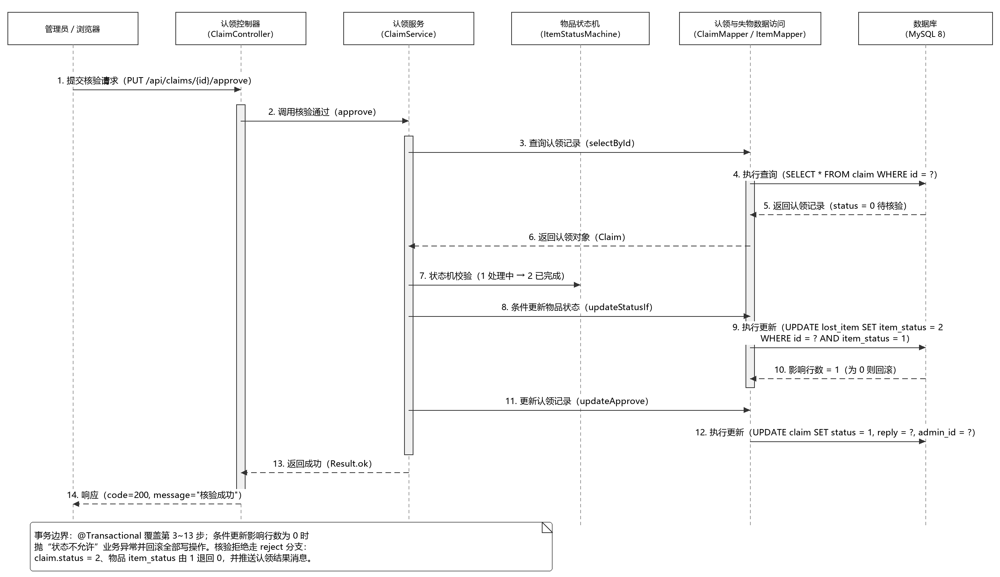

图 6-2 认领核验时序图

实现要点：两个条件更新都带原状态作为 WHERE 条件，用影响行数判断是否被并发抢先；`@Transactional(rollbackFor = Exception.class)` 保证任何异常回滚；消息推送使用 `REQUIRES_NEW` 独立事务，即使主事务回滚，通知仍会送达（设计取舍见 U5.3）。

### 6.5 前后端契约约定

1. **时间格式**：请求与响应统一 `yyyy-MM-dd HH:mm:ss`，前端不做二次转换。
2. **空值**：字符串空传 `""` 而非 `null`，避免 MyBatis-Plus 条件误判；日期与 id 用 `null`。
3. **图片地址**：接口返回相对路径 `/uploads/...`，前端直接拼接为 `src`，由 Vite 代理或静态映射转发。
4. **错误处理**：前端 axios 拦截器统一处理：`code=401` 清除登录态并跳转登录页；`code=403` 提示无权限；其余 `code>=400` 用 `ElMessage.error(message)` 展示后端 message，前端不再拼装业务文案。
5. **幂等**：审核、核验、关闭等按钮在前端置 loading，防止重复点击；后端以条件更新做最终防护。

## 7 界面详细设计

### 7.1 界面设计原则

界面遵循"信息优先、操作最少、状态可见"三条原则，满足 NFR-03（界面友好，3 次点击内到达主要功能）。

| 项 | 规范 |
|---|---|
| 基准宽度 | 1200px 定宽居中，最小支持 1024px；后台内容区随窗口自适应 |
| 布局 | 顶栏 58px + 内容区；后台左侧 180px 侧栏 + 右侧内容区 |
| 字体 | 系统默认中文字体（微软雅黑/苹方），正文 14px，标题 16~20px，数字指标 28~32px |
| 主色 | 蓝色 `#3B7DF6`（主按钮、链接、选中态），成功 `#67C23A`，警告 `#E6A23C`，危险 `#F56C6C` |
| 圆角与间距 | 卡片圆角 6px，模块间距 16~20px，表单行高 40px |
| 组件库 | Element Plus：表格 el-table、表单 el-form、分页 el-pagination、标签 el-tag、弹窗 el-dialog、消息 ElMessage |
| 状态色 | 待审核/待核验=橙，进行中=蓝，处理中=紫，已完成=绿，已关闭=灰，驳回/拒绝=红 |
| 空状态 | 列表无数据时显示插图 + "暂无数据"文案，不显示空表格 |

### 7.2 页面清单与原型

| 编号 | 页面 | 路由 | 原型 |
|---|---|---|---|
| P1 | 首页（搜索 + 最新信息 + 分类入口） | `/` | 图 7-1 |
| P2 | 信息详情（图片、描述、留言、认领按钮） | `/items/:id` | 图 7-2 |
| P3 | 发布/编辑信息 | `/items/new`、`/items/:id/edit` | 图 7-3 |
| P4 | 登录与注册（同页双卡切换） | `/login` | 图 7-4 |
| P5 | 个人中心（资料、我的发布/认领/留言） | `/profile` | 图 7-5 |
| P6 | 消息中心 | `/messages` | 图 7-6 |
| P7 | 后台数据统计 | `/admin` | 图 7-7 |
| P8 | 后台信息审核 | `/admin/audit` | 图 7-8 |
| P9 | 后台认领核验 | `/admin/claims` | 图 7-9 |
| P10 | 信息列表（筛选、排序、分页） | `/items` | 图 7-10 |
| P11 | 后台分类管理 | `/admin/categories` | 图 7-11 |
| P12 | 后台用户管理 | `/admin/users` | 图 7-12 |

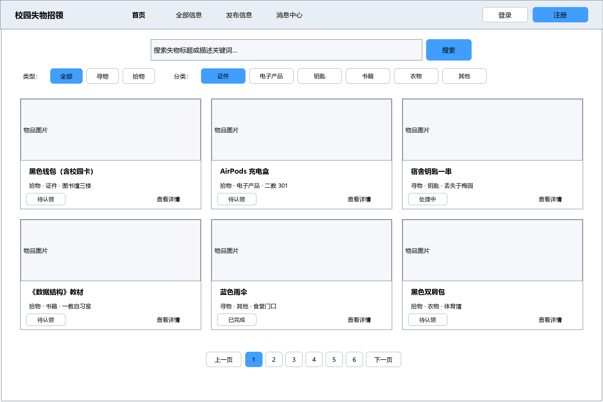

图 7-1 首页界面原型

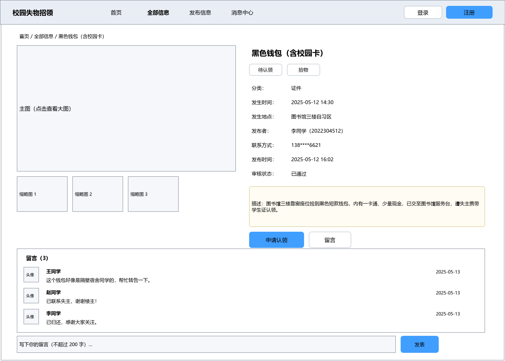

图 7-2 信息详情界面原型

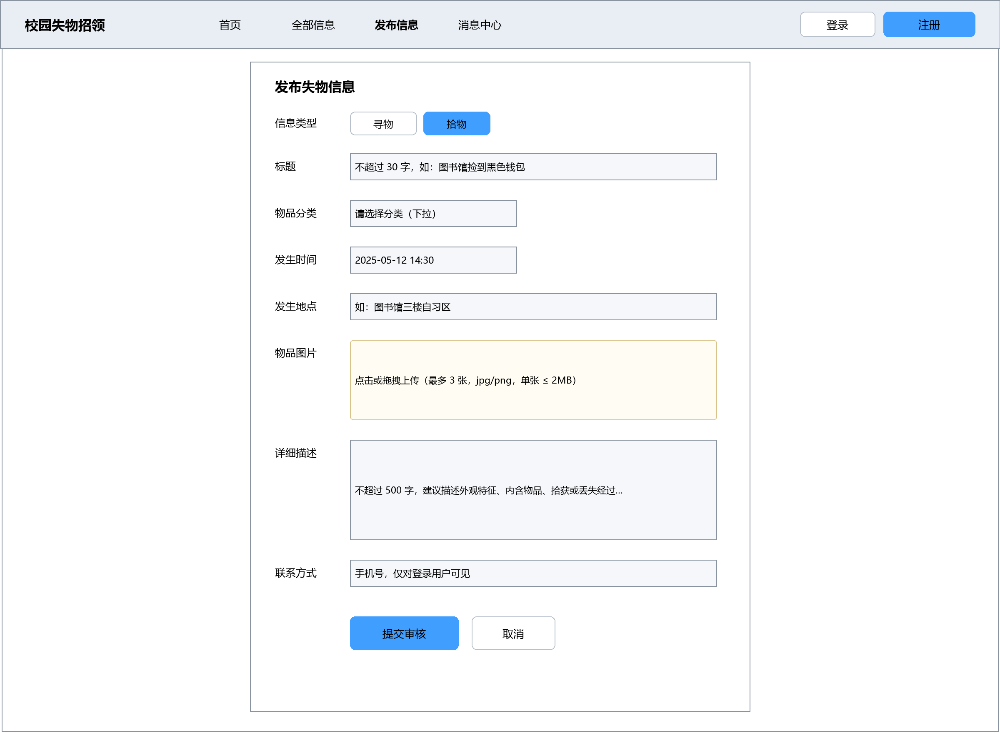

图 7-3 发布信息界面原型

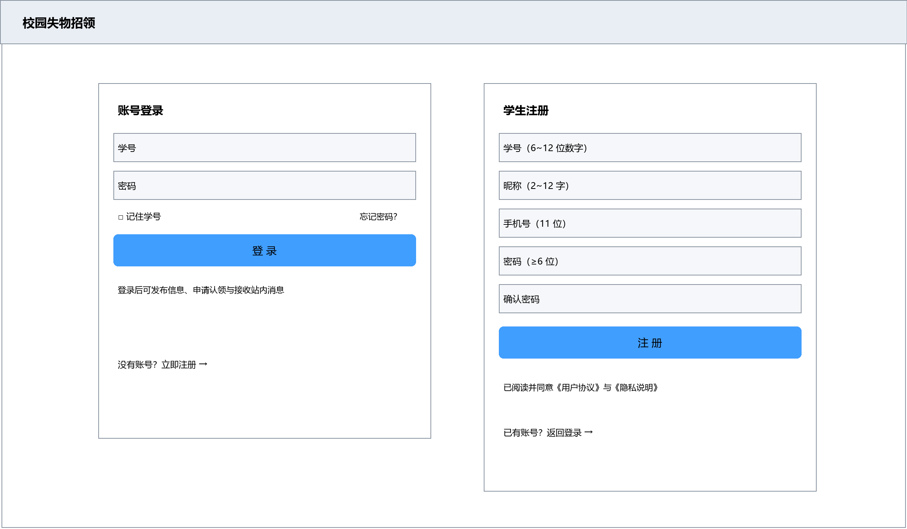

图 7-4 登录与注册界面原型

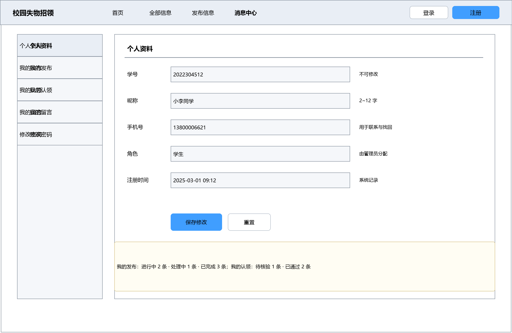

图 7-5 个人中心界面原型

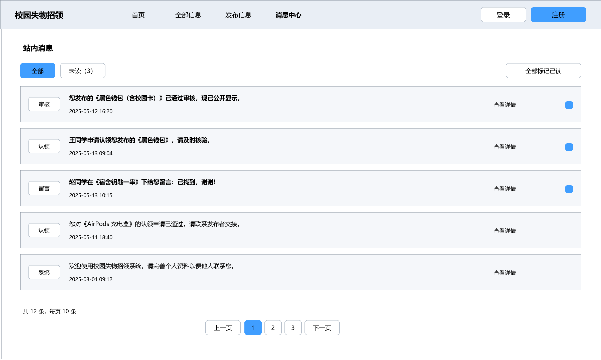

图 7-6 消息中心界面原型

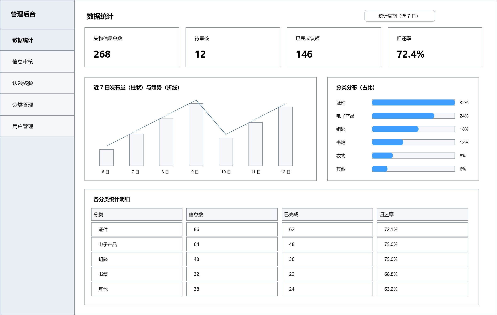

图 7-7 后台数据统计界面原型

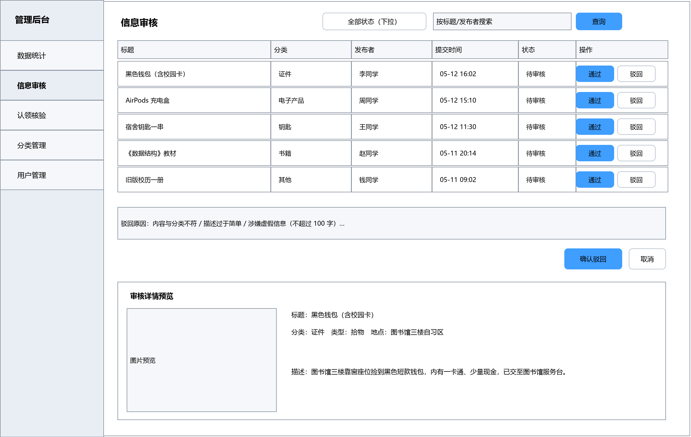

图 7-8 后台信息审核界面原型

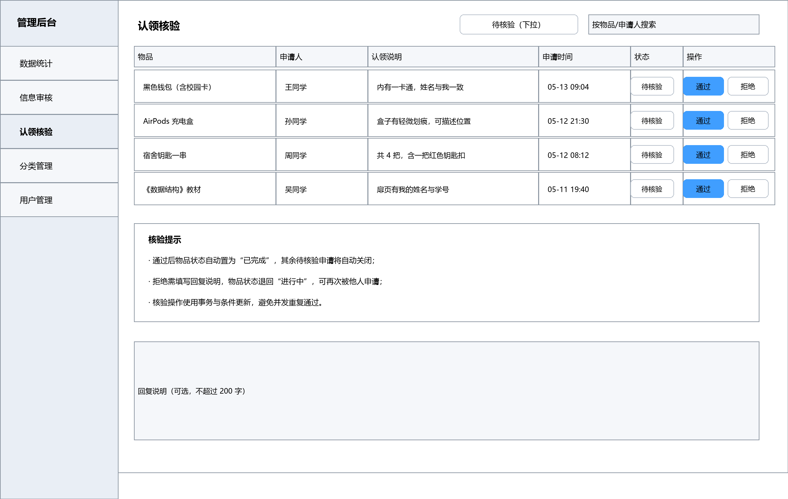

图 7-9 后台认领核验界面原型

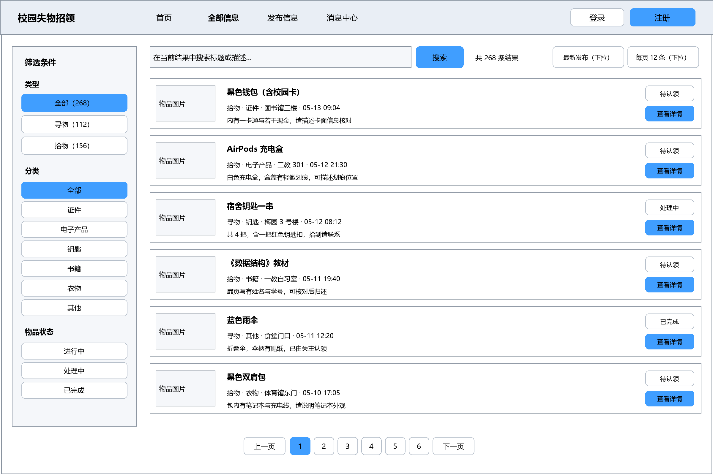

图 7-10 信息列表页界面原型

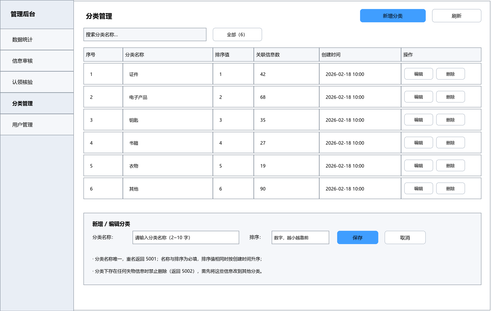

图 7-11 后台分类管理界面原型

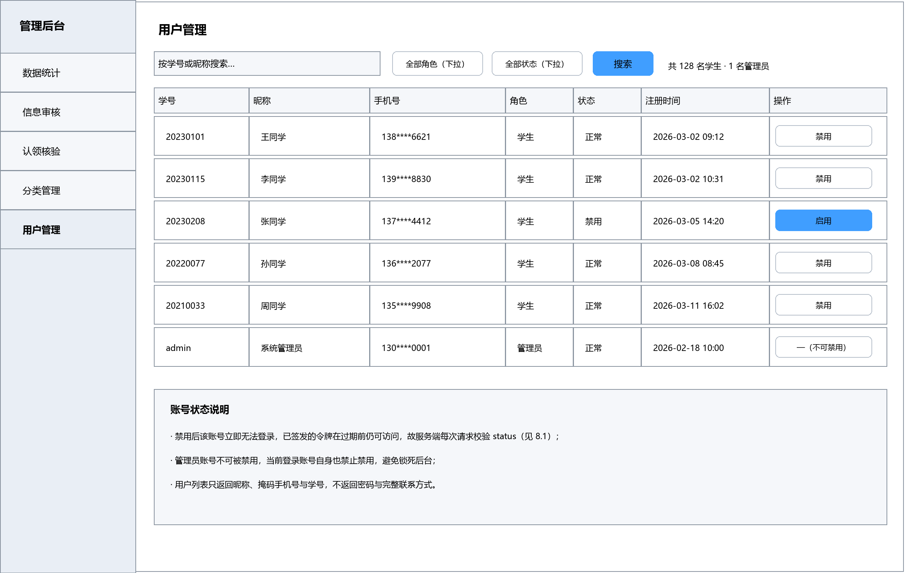

图 7-12 后台用户管理界面原型

### 7.3 页面与数据映射

| 页面 | 主要接口 | 关键数据 | 可执行操作 |
|---|---|---|---|
| P1 首页 | GET /api/items?size=12、GET /api/items?keyword= | 最新 12 条卡片、分类快捷入口 | 搜索、切换分类、进入详情 |
| P2 详情 | GET /api/items/{id}、POST /api/claims、POST /api/comments | 主信息、图片、留言、myClaimStatus | 申请认领、留言、删除自己的留言 |
| P3 发布 | POST /api/upload/image、POST /api/items、PUT /api/items/{id} | 表单字段、最多 3 张图 | 保存、返回、编辑态下提交修改 |
| P4 登录 | POST /api/auth/login、POST /api/auth/register | token、user | 登录、注册、切换卡片 |
| P5 个人中心 | profile 与 user/items、claims、comments | 资料、三个 Tab 列表 | 改资料、改密码、关闭自己的信息 |
| P6 消息 | GET /api/messages、PUT /{id}/read、GET /unread-count | 消息列表、未读数 | 标记已读、跳转关联信息 |
| P7 统计 | GET /api/admin/stats | 4 个指标、7 日趋势、分类分布 | 无（只读） |
| P8 审核 | GET /api/admin/items/audit、PUT /{id}/audit | 待审核列表、详情预览 | 通过、驳回（填原因） |
| P9 核验 | GET /api/claims、approve、reject | 待核验申请、申请人信息 | 通过（写备注）、拒绝（填原因） |
| P10 列表 | GET /api/items（type、categoryId、itemStatus、keyword、page、size） | 分页结果、分类计数 | 切换筛选、排序、翻页、进入详情 |
| P11 分类 | GET /api/admin/categories、POST、PUT /{id}、DELETE /{id} | 分类列表、各分类信息数 | 新增、改名改排序、删除（有信息则拒绝） |
| P12 用户 | GET /api/admin/users、PUT /{id}/status | 学号、昵称、掩码手机号、角色、状态 | 搜索、按角色/状态筛选、启用或禁用 |

### 7.4 关键交互序列

**发布信息**：点击"发布信息" → 未登录则跳转登录并带回跳地址 → 选择类型（寻物/拾物）→ 填写标题、分类、时间、地点、联系方式、描述 → 选择图片（前端即时校验数量与大小，缩略图可删除）→ 点击提交 → 前端校验必填项 → 逐张上传图片得到 URL → 提交表单 → 成功提示"已提交，等待管理员审核"并跳转个人中心"我的发布"。

**申请认领**：详情页点击"我要认领" → 未登录跳转登录 → 弹出对话框填写认领说明（10~300 字）→ 提交 → 成功提示"申请已提交，请等待管理员核验"→ 按钮变为"已申请，待核验"（依据 myClaimStatus 禁用）。

**核验通过**：后台列表中点击"通过" → 二次确认（"确认该申请人已领走物品？通过后物品将标记为已完成"）→ 调用接口 → 成功后行内状态更新、列表刷新 → 失败时保留原状态并提示后端 message。

**审核驳回**：点击"驳回" → 弹出输入框要求填写原因（2~100 字，必填校验）→ 提交 → 成功后该行从待审核列表移除，发布者收到消息。

### 7.5 前端状态与提示规范

1. **加载态**：列表用骨架屏或 `v-loading`，按钮提交期间置 `loading` 并禁用。
2. **空态**：区分"无数据"与"筛选无结果"，后者提供"清除筛选"按钮。
3. **错误提示**：只展示后端 message；网络异常统一提示"网络异常，请稍后重试"；401 静默跳转登录。
4. **权限提示**：非发布者看不到"编辑/关闭"，非管理员不渲染后台入口；直接访问受限路由由守卫拦截。
5. **表单校验**：前端校验与后端校验规则一致（长度、格式），提交前拦截，减少无效请求。

### 7.6 兼容性与适配

支持 Chrome 90+ 与 Edge 90+（NFR-04），不做移动端专项适配，但保证 1024px 宽度下不出现横向滚动；图片列表使用 `object-fit: cover` 统一比例；ECharts 容器在窗口 `resize` 时调用 `chart.resize()`。

## 8 安全与权限设计

### 8.1 认证

- 采用无状态 JWT（HS256），有效期 12 小时，密钥配置在环境变量 `JWT_SECRET`，禁止硬编码进仓库。
- 令牌只携带 `uid` 与 `role`，不携带昵称、手机号等可变或敏感信息。
- 每个请求由 `JwtInterceptor` 校验签名、有效期，并查库确认账号未被禁用，保证禁用即时生效。
- 退出登录由前端清除令牌，服务端不保存会话；令牌泄露的有效窗口由 12 小时有效期约束。

### 8.2 授权矩阵

| 资源 / 操作 | 游客 | 学生 | 管理员 |
|---|---|---|---|
| 浏览列表、详情 | 可（联系方式掩码） | 可 | 可（不掩码） |
| 发布、编辑自己的信息 | 否 | 可 | 可（任意信息） |
| 关闭信息 | 否 | 仅自己的 | 可 |
| 发起认领 | 否 | 可（非自己发布） | 可 |
| 核验认领 | 否 | 否 | 可 |
| 留言 | 否 | 可 | 可 |
| 删除留言 | 否 | 仅自己的 | 可 |
| 查看消息 | 否 | 仅自己的 | 仅自己的 |
| 审核、分类、用户、统计 | 否 | 否 | 可 |

授权实现为三层：路由守卫（前端隐藏入口）、拦截器（令牌与角色）、Service 内归属校验（`userId` 是否等于当前用户）。任何一层缺失都不影响最终安全，但不能替代后两层。

### 8.3 密码与会话安全

- 密码使用 BCrypt（cost=10）单向散列，库中永不存明文；比对使用 `matches()`，不可逆。
- 修改密码需验证原密码，并以原摘要作为乐观更新条件，防止并发覆盖。
- 密码策略：6~20 位，不强制复杂度（校园场景平衡可用性与安全）；禁止与学号相同（前端提示，后端校验）。
- 登录失败统一返回"学号或密码错误"，不区分账号是否存在，防止账号枚举。

### 8.4 输入安全

| 风险 | 防护措施 |
|---|---|
| SQL 注入 | 全部使用 MyBatis `#{}` 预编译参数；动态排序字段用白名单映射，不拼接用户输入 |
| XSS | 前端 Vue 默认转义插值；后端对富文本不做放行（本系统无富文本字段）；留言与描述在返回时原样输出，由前端转义 |
| 越权访问 | 所有按 id 操作的接口校验资源归属；管理接口双重角色校验 |
| 文件上传 | 扩展名白名单 + MIME 校验 + 文件头魔数校验 + 2MB 限制 + UUID 重命名 + 存储目录不在 Web 根路径下 |
| 参数篡改 | 服务端 Bean Validation 校验全部入参，不信任前端校验 |
| 重放与重复提交 | 状态变更接口用条件更新保证幂等；前端按钮 loading |

### 8.5 敏感数据保护

- 手机号在非授权场景掩码为 `138****6621`（详情页对非本人、非管理员）。
- 日志不打印密码、完整手机号、token；异常日志只打印业务 id。
- 接口返回的 VO 中不包含 `password` 字段，由 `UserVO` 的字段定义本身保证。

### 8.6 传输与部署安全

- 生产环境通过 Nginx 统一入口，启用 HTTPS；后端只监听本机端口，不直接暴露。
- CORS 只允许前端域名；上传目录禁止执行脚本（Nginx 对该路径 `add_header Content-Disposition` 或直接由后端流式返回）。
- 数据库账号使用最小权限（仅 `lost_found` 库的 DML 与 DDL 权限），不在配置中沿用 root。
- 部署时关闭 MyBatis SQL 日志与 Spring Boot DevTools。

## 9 出错处理设计

### 9.1 异常体系

系统自定义两类异常：`BusinessException`（携带 `ResultCode`，可预期，不打堆栈）与框架异常（参数校验、数据库、未捕获异常，由全局处理器转换）。所有异常最终转换为统一响应，绝不把堆栈或 SQL 泄露给前端。

```java
@RestControllerAdvice
public class GlobalExceptionHandler {

    @ExceptionHandler(BusinessException.class)
    public ResponseEntity<Result<Void>> handleBusiness(BusinessException e) {
        ResultCode rc = e.getCode();
        return ResponseEntity.status(rc.getHttpStatus())
                .body(Result.fail(rc.getCode(), e.getMessage() == null ? rc.getMessage() : e.getMessage()));
    }

    @ExceptionHandler(MethodArgumentNotValidException.class)
    public ResponseEntity<Result<Void>> handleValid(MethodArgumentNotValidException e) {
        String msg = e.getBindingResult().getFieldErrors().stream()
                .findFirst().map(FieldError::getDefaultMessage).orElse("参数校验失败");
        return ResponseEntity.badRequest().body(Result.fail(1001, msg));
    }

    @ExceptionHandler(Exception.class)
    public ResponseEntity<Result<Void>> handleOther(Exception e) {
        log.error("unexpected error", e);
        return ResponseEntity.status(500).body(Result.fail(9999, "系统繁忙，请稍后重试"));
    }
}
```

### 9.2 错误码规范

四位业务码分段：1xxx 参数与账号、2xxx 认证、权限与状态、3xxx 认领、4xxx 文件、5xxx 分类、9999 系统异常；与 HTTP 状态的映射为：参数类 400、未认证 401、无权限 403、资源不存在 404、系统异常 500。完整 20 条错误码见《API接口详细规格.md》第 1.4 节，此处不重复。

### 9.3 前端错误处理

axios 响应拦截器按 code 分派：401 清除 token 并跳转登录（附 `redirect`）；403 提示"无权限"；404 提示"内容不存在或已被删除"并返回上一页；400 直接展示 message；500/网络错误提示"服务暂时不可用"。表单提交失败保留用户已填内容，不清空表单。

### 9.4 日志与追踪

| 场景 | 级别 | 内容 |
|---|---|---|
| 请求入口 | INFO | 方法、路径、uid、耗时 |
| 状态变更 | INFO | 业务 id、原状态、新状态、操作人 |
| 业务异常 | WARN | 错误码、业务 id、原因 |
| 系统异常 | ERROR | 完整堆栈、请求路径与参数（脱敏） |
| 定时任务/初始化 | INFO | 执行结果与耗时 |

日志按天滚动，保留 15 天；单文件上限 50MB。排查问题时以业务 id（itemId、claimId、uid）串联。

### 9.5 常见故障与降级

| 故障 | 表现 | 处理 |
|---|---|---|
| 数据库连接耗尽 | 接口 500 | HikariCP 最大连接 20、超时 3s，前端提示稍后重试 |
| 图片目录不可写 | 上传失败 9999 | 记录日志并提示"上传失败"，不影响信息正文提交（允许无图发布） |
| 消息推送失败 | 用户收不到通知 | 推送异常被捕获并记日志，主业务不回滚 |
| 并发核验 | 一方成功一方 3002 | 前端提示"该申请已被处理"并刷新列表 |
| 令牌过期 | 401 | 前端跳转登录，登录后回跳原页面 |

## 10 设计追踪矩阵

矩阵保证"每条需求都有实现它的程序单元与接口"，是综合测试设计用例的依据。

| 需求 | 用例 | 程序单元 | 主要接口 | 数据表 | 页面 | 验收 |
|---|---|---|---|---|---|---|
| FR-01 注册 | UC-01 | U1.1 | POST /api/auth/register | user | P4 | AC-01 |
| FR-02 登录退出 | UC-02 | U1.2、U1.3 | POST /api/auth/login、logout | user | P4 | AC-01 |
| FR-03 个人中心 | UC-03 | U1.4、U1.5、U1.6 | /api/user/profile、password、items、claims、comments | user、lost_item、claim、comment | P5 | AC-02 |
| FR-04 账号管理 | UC-12 | U1.7、U6.3 | /api/admin/users 系列 | user | P9 侧栏 /admin/users | AC-06 |
| FR-05 发布 | UC-04 | U2.1 | POST /api/items | lost_item、item_image | P3 | AC-03 |
| FR-06 编辑下架 | UC-05 | U2.3、U2.4 | PUT /api/items/{id}、/close | lost_item | P5 | AC-03 |
| FR-07 图片上传 | UC-04 | U2.2 | POST /api/upload/image | item_image | P3 | AC-03 |
| FR-08 列表 | UC-06 | U3.1 | GET /api/items | lost_item、item_image | P1、P2 列表 | AC-04 |
| FR-09 筛选 | UC-06 | U3.1 | GET /api/items?type&categoryId | lost_item | P1 | AC-04 |
| FR-10 搜索 | UC-06 | U3.2 | GET /api/items?keyword | lost_item | P1 | AC-04 |
| FR-11 详情 | UC-07 | U3.3 | GET /api/items/{id} | lost_item、item_image、comment | P2 | AC-04 |
| FR-12 状态流转 | UC-08 | U4.1 | 内部（被 U2.4/U4.3/U4.4 复用） | lost_item、claim | P2、P5 | AC-05 |
| FR-13 认领申请 | UC-08 | U4.2 | POST /api/claims | claim、lost_item | P2 | AC-05 |
| FR-14 管理员核验 | UC-09 | U4.3、U4.4、U4.5 | GET /api/claims、/approve、/reject | claim、lost_item、message | P9 | AC-05 |
| FR-15 关闭信息 | UC-10 | U2.4、U4.1 | PUT /api/items/{id}/close | lost_item、claim | P5 | AC-05 |
| FR-16 留言 | UC-07 | U5.1、U5.2 | POST /api/comments、DELETE /api/comments/{id} | comment | P2 | AC-04 |
| FR-17 站内消息 | UC-11 | U5.3、U5.4 | GET /api/messages、/read、/unread-count | message | P6 | AC-06 |
| FR-18 信息审核 | UC-13 | U6.1 | GET /api/admin/items/audit、PUT /{id}/audit | lost_item、message | P8 | AC-06 |
| FR-19 分类管理 | UC-14 | U6.2 | /api/admin/categories 系列 | category、lost_item | P8 侧栏 /admin/categories | AC-06 |
| FR-20 数据统计 | UC-14 | U6.4 | GET /api/admin/stats | lost_item、category | P7 | AC-07 |
| NFR-01 性能 | — | 索引设计、分页上限、统计聚合 | 全部 | 全部 | — | AC-08 |
| NFR-02 安全 | — | 第 8 章 | 全部 | user | — | AC-08 |
| NFR-03 易用性 | — | 第 7 章 | — | — | 全部 | AC-08 |
| NFR-04 兼容性 | — | 7.6 节 | — | — | 全部 | AC-08 |
| NFR-05 分层架构 | — | 2.3、3.2 节 | — | — | — | AC-08 |

## 11 设计约束与待确认问题

### 11.1 设计约束

1. **部署形态**：单机部署，前端静态资源与后端服务在同一台机器，Nginx 反向代理；不引入 Redis、消息队列、对象存储等中间件（本期范围外）。
2. **数据规模**：用户 ≤5000、信息 ≤2 万条、并发 ≤20（NFR-01），所有设计以此为前提；超出后需重新评估索引与搜索方案。
3. **图片存储**：本地磁盘，单张 ≤2MB、每条 ≤3 张，不做压缩与 CDN；服务迁移需同步迁移 `uploads` 目录。
4. **状态只进不退**：物品"已完成""已关闭"为终态，不提供撤销；如需恢复，由管理员在数据库层面处理（本期不做后台撤销功能）。
5. **留言为平铺结构**：不支持回复某条留言，不支持富文本与图片。
6. **无密码找回**：本期不实现短信/邮箱找回，学生忘记密码需管理员重置（管理员重置功能在 U1.7 基础上可扩展）。
7. **接口数量差异**：概要设计列出 32 个接口，本设计新增 `GET /api/claims`（管理员待核验列表），共 33 个。原因是概要设计的认领接口只含"通过/拒绝"两个写操作，而后台核验页必须有可查询的列表，属于概要设计的细化补齐，已同步在接口规格文档中说明。

### 11.2 待确认问题

| 编号 | 问题 | 影响 | 建议 |
|---|---|---|---|
| Q1 | 是否需要对"拾物"信息做本人自证（如上传拾获地点照片） | 影响 U2.1 字段与审核工作量 | 本期以管理员人工审核为准，不增加字段 |
| Q2 | 归还完成后是否允许双方互评 | 影响数据模型（新增评价表）与页面 | 本期不做，留待二期 |
| Q3 | 消息是否需要"全部已读"与消息删除 | 影响 U5.4 接口数量 | 前端可循环调用单条已读实现，暂不新增接口 |
| Q4 | 图片是否存在孤儿文件（上传后未提交表单） | 磁盘占用 | 本期由运维定期清理 7 天前无引用文件，不做程序内清理 |
| Q5 | 是否需要导出统计报表（Excel） | 影响 U6.4 | 本期仅页面展示，导出留待二期 |
| Q6 | 管理员是否需要操作审计日志（谁审核了哪条） | 影响数据模型 | 当前依赖应用日志（第 9.4 节）记录，未建审计表 |

以上问题不影响本期编码与测试，编码阶段按"建议"列执行，若指导老师或团队成员有不同意见，在编码前确认后更新本文档。

### 11.3 与概要设计的一致性说明

本设计的模块划分、接口前缀、统一响应、7 张表结构与错误码分段均与《概要设计说明书》保持一致；细化与差异点集中在三处：新增 `GET /api/claims` 接口（理由见 11.1 第 7 条）；管理员账号改为启动时初始化（理由见 5.6 节）；详情接口的联系方式按登录态掩码（概要设计仅规定"展示联系方式"，未细化脱敏规则）。三处均属于详细设计阶段的必要细化，不改变总体架构与外部契约。

